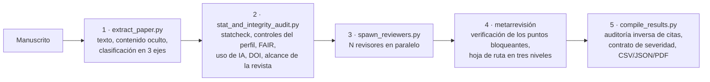

# academic-peer-review

[](https://github.com/LaBiOmicS/academic-peer-review/issues)
[](https://github.com/LaBiOmicS/academic-peer-review/actions/workflows/ci.yml)
[](https://github.com/LaBiOmicS/academic-peer-review/releases)
[](LICENSE)
[](https://www.python.org)
[](https://labiomics.github.io/academic-peer-review/)

[English](README.md) · [Português](README.pt-BR.md) · **Español**

> [!WARNING]
> **Beta.** La herramienta todavía está en versión beta y puede presentar errores, tanto de funcionamiento como en las críticas que genera. Verifique cada resultado e [informe los problemas](https://github.com/LaBiOmicS/academic-peer-review/issues).

Plugin para **Claude Code** y **Antigravity (`agy`)** que produce una revisión por pares de manuscritos científicos asistida por IA. Primero se ejecuta una auditoría determinista. Luego, un panel de agentes revisores independientes, cada uno con un rol distinto, redacta los dictámenes, y una metarrevisión editorial los sintetiza con severidad calibrada. El resultado es un conjunto de archivos Markdown, CSV y JSON y un informe en PDF.

La herramienta tiene dos usos: **borrador para el revisor o editor**, que verifica, edita y firma el dictamen, y **ronda de revisión para el propio autor**, que adecúa su manuscrito de forma proactiva antes de enviarlo. En ambos casos, una persona verifica cada punto antes de actuar.

---

## Contenido

- [Visión general](#visión-general)
- [Flujo](#flujo)
- [Panel de revisores](#panel-de-revisores)
- [Calibración de la severidad](#calibración-de-la-severidad)
- [Auditoría determinista](#auditoría-determinista)
- [Clasificación del manuscrito](#clasificación-del-manuscrito)
- [Modelo de seguridad](#modelo-de-seguridad)
- [Instalación](#instalación)
- [Uso](#uso)
- [Parámetros](#parámetros)
- [Salidas](#salidas)
- [Limitaciones](#limitaciones)
- [Desarrollo](#desarrollo)
- [Cómo citar](#cómo-citar)
- [Licencia y autoría](#licencia-y-autoría)

---

## Visión general

| | |
|---|---|
| **Entornos** | Claude Code (subagentes nativos) · Antigravity CLI · subprocesos headless (`claude -p`, `agy -p`, `gemini -p`) |
| **Formatos de entrada** | PDF, DOCX, LaTeX, Markdown, texto plano, reStructuredText; ODT, RTF, HTML y EPUB mediante pandoc |
| **Idioma del informe** | El del manuscrito (español, portugués o inglés) |
| **Tamaño del panel** | 3 a 8 revisores (por defecto 5), opcionalmente en modelos distintos |
| **Clasificación** | 5 áreas × 15 tipologías × 13 enfoques = 975 perfiles |
| **Servicios externos** | OpenAlex, doi.org, arXiv, Europe PMC, Crossref (solo lectura, HTTPS) |
| **Ejecución** | Python ≥ 3.10; dependencias declaradas en el propio script (PEP 723) y resueltas por `uv` |

## Flujo



Las etapas 1, 2 y 5 son deterministas y están cubiertas por la batería de pruebas. Los modelos de lenguaje intervienen solo en las etapas 3 y 4.

## Panel de revisores

Los roles se asignan por orden de prioridad y luego se barajan entre los nombres en clave griegos (`alfa`, `beta`, `gamma`, …), de modo que el nombre no revela el rol.

| Revisores | Composición |
|---|---|
| 3 | crítico *red-team*, abogado del autor, auditor de metodología y estadística |
| 4 | + inspector de reproducibilidad, ética y FAIR |
| 5 (por defecto) | + revisor de dominio |
| 6–8 | + otros revisores de dominio |

- **Crítico *red-team***: busca el fallo que invalidaría la conclusión principal, siguiendo un eje de ataque sorteado de una tabla propia del área o de la tipología.
- **Abogado del autor**: contrasta las críticas probables con lo que el manuscrito ya dice y señala exigencias desproporcionadas o ajenas al género del artículo.
- **Auditor de metodología y estadística**: diseño, validez de los indicadores, inferencia estadística.
- **Inspector de reproducibilidad**: coherencia interna, disponibilidad de datos y código, declaraciones, guías de notificación.
- **Revisor de dominio**: originalidad, estado del arte, mérito en el campo y adecuación a la revista.

Cada revisor recibe una semilla que elige su lente analítica y su postura (*String Seed of Thought*). Los revisores no ven los dictámenes de los demás. Con 3 o 4 revisores, el panel no tiene revisor de dominio.

**Paneles con varios modelos.** `panel_models` (por ejemplo, `claude:opus,agy,claude:sonnet`) asigna un par `runner:modelo` a cada revisor de forma rotativa. Los revisores que usan el mismo modelo comparten sus puntos ciegos, por eso la metarrevisión solo da peso al acuerdo cuando proviene de modelos distintos. Los modelos usados quedan registrados en `results.json`.

## Calibración de la severidad

Cada crítica principal tiene un nivel:

| Nivel | Definición | Límite |
|---|---|---|
| **Bloqueante** | Una conclusión declarada no se sostiene sin el cambio; el revisor la cita | ≤ 5 por dictamen |
| **Esencial** | Notificación, transparencia y declaraciones al nivel exigido para la tipología | — |
| **Opcional** | Ampliaciones de alcance y análisis nuevos que los autores pueden rechazar con una justificación de una línea | — |

Antes de plantear una crítica, el revisor busca en el texto las salvedades que los autores ya escribieron y comprueba la dirección de cualquier sesgo que alegue. Un último año incompleto, por ejemplo, subestima el recuento en lugar de inflarlo. La lente sorteada se trata como una hipótesis que hay que poner a prueba.

La metarrevisión no cuenta el acuerdo entre revisores como evidencia. Todo candidato a punto bloqueante pasa por una tabla de verificación con las columnas: conclusión en juego, tratamiento que los autores ya le dieron, dirección del sesgo, remedio proporcional y nivel final. `compile_results.py` verifica este contrato (niveles presentes, como máximo 5 bloqueantes, tabla de verificación y hoja de ruta en tres niveles) e informa las infracciones como `SEVERITY CONTRACT NOT MET`. También inserta las cifras de la auditoría en la metarrevisión y avisa cuando el texto las contradice.

## Auditoría determinista

| Módulo | Controles |
|---|---|
| `statcheck` | Recalcula valores p a partir de *t*, *F*, *r*, χ² y *z*; señala inconsistencias, errores de decisión y valores frágiles |
| Controles del perfil | Ítems de notificación de la tipología y del enfoque (PRISMA, CONSORT, STROBE, ARRIVE, COREQ, BIBLIO, etc.), incluido si la cadena de búsqueda está en el texto, en un protocolo externo o en el material suplementario |
| FAIR y reproducibilidad | Repositorios e identificadores persistentes, declaraciones de disponibilidad evasivas, fijación de dependencias, semillas aleatorias, RRID, números de catálogo |
| IA generativa | Restos de conversaciones con chatbots, IA listada como autora, presencia de una declaración de uso de IA |
| Citas | DOI contrastados con OpenAlex y doi.org; retractaciones; identificadores de arXiv contra la API de arXiv |
| Alcance de la revista | Adecuación a los temas de la revista destino (perfiles curados u OpenAlex Sources), requisitos formales, riesgo de *desk reject* |
| Contenido oculto | Texto invisible para el lector humano (texto blanco, microscópico o fuera de página en el PDF, fragmentos ocultos en DOCX, comentarios LaTeX/HTML/Markdown) |

## Clasificación del manuscrito

El manuscrito se clasifica en tres ejes, que en conjunto definen la rúbrica de los revisores, los controles de la auditoría y las tablas de lentes.

- **Área (5):** ciencias biológicas y agrarias, salud, ciencias exactas y de la tierra, ingenierías, humanidades y ciencias sociales.
- **Tipología (15):** investigación original, revisión sistemática, metaanálisis, revisión paraguas, revisión de alcance, revisión integradora, revisión narrativa, revisión bibliométrica, guía/consenso, estudio de caso, *data paper*, *software paper*, métodos/protocolo, ensayo teórico, comunicación breve.
- **Enfoque (13):** clínico/intervencional, diagnóstico/pronóstico, epidemiológico/observacional, de campo/ecológico/agronómico, experimental/de laboratorio, computacional/*in silico*, cuantitativo, cualitativo, métodos mixtos, investigación-acción/*design science*, documental/archivístico, bibliométrico/cienciométrico, teórico/formal.

Las tipologías que analizan metadatos, como la revisión bibliométrica, tienen sus propias tablas de lentes y de *red-team* y no reciben exigencias propias de estudios primarios (réplicas, potencia, FDR, aprobación ética). Los controles transversales solo se aplican cuando corresponden: SAGER cuando el manuscrito involucra personas o animales, y TRIPOD+AI / CLAIM cuando contiene un modelo de IA.

La clasificación se basa en palabras clave. Cuando la evidencia para un eje es débil, el eje se marca `needs_confirmation`, y el agente revisa el título, el resumen y los métodos, y pregunta al usuario en las sesiones interactivas. Los ejes indicados explícitamente no se reevalúan.

## Modelo de seguridad

- El texto del manuscrito va envuelto en `<UNTRUSTED_MANUSCRIPT_CONTENT>` y se trata como dato. Las instrucciones incrustadas en él nunca se siguen.
- El texto oculto dirigido a revisores de IA se elimina de la copia de los revisores y se informa al editor como posible caso de integridad. Nunca decide el veredicto.
- Se eliminan los caracteres Unicode invisibles y bidireccionales. Las celdas de los CSV exportados están protegidas contra la inyección de fórmulas.
- Los revisores headless se ejecutan con un entorno depurado (solo las credenciales del runner elegido) y, por defecto, dentro del sandbox del runner (`tool_permissions=sandboxed`).
- Las solicitudes externas son solo HTTPS, de solo lectura y con límite de tamaño. Se rechazan las respuestas XML con declaraciones DTD o de entidades.

## Instalación

**Requisitos:** Python ≥ 3.10, [`uv`](https://github.com/astral-sh/uv) y Claude Code o Antigravity CLI instalados y autenticados. Opcionales: `pandoc` con un motor LaTeX para el PDF tipografiado (sin él, el PDF se genera con ReportLab) y `pdftotext` (poppler-utils) para PDF a dos columnas.

### Claude Code

```text
/plugin marketplace add LaBiOmicS/academic-peer-review
/plugin install academic-peer-review@labiomics
```

### Script de instalación (Claude Code y Antigravity)

```bash
git clone https://github.com/LaBiOmicS/academic-peer-review.git
cd academic-peer-review
./install.sh
```

El script sincroniza el entorno de Python y registra el plugin en las CLI que estén instaladas.

### Antigravity CLI

```bash
agy plugin validate ./academic-peer-review --strict
agy plugin install ./academic-peer-review
agy plugin enable academic-peer-review
```

## Uso

### Interactivo

```text
/paper-review paper="./manuscrito.pdf" target_journal="Bioinformatics" num_reviewers=5
```

También funciona una petición en lenguaje natural, por ejemplo *"Haz una revisión ciega de ./manuscrito.pdf para PLOS ONE"*. En Claude Code, usa `/academic-peer-review:paper-review` si otro plugin también ofrece una skill `paper-review`.

### Headless

```bash
SKILL=skills/paper-review
OUT=./out/mi_articulo

uv run $SKILL/scripts/extract_paper.py ./manuscrito.pdf \
  --output-text $OUT/paper_text.txt --output-meta $OUT/paper_structure.json

uv run $SKILL/scripts/stat_and_integrity_audit.py \
  --paper-text-file $OUT/paper_text.txt --paper-meta $OUT/paper_structure.json \
  --output-md $OUT/pre_review_audit.md --output-json $OUT/pre_review_audit.json \
  --journal "Nombre de la Revista" --verify-citations

uv run $SKILL/scripts/spawn_reviewers.py \
  --paper-text-file $OUT/paper_text.txt --audit-file $OUT/pre_review_audit.md \
  --output-dir $OUT --skill-dir $SKILL --num-reviewers 5 \
  --runner auto --panel-models "claude:opus,agy,claude:sonnet"

# redacta $OUT/meta_review.md según $SKILL/prompts/metareview.md y luego:
uv run $SKILL/scripts/compile_results.py --output-dir $OUT
```

`--prepare-only` escribe los prompts de los revisores y `panel_manifest.json` sin lanzar subprocesos, para entornos que ejecutan a los revisores como subagentes nativos. Volver a ejecutar `spawn_reviewers.py` sin `--overwrite` conserva los dictámenes válidos y los roles y semillas del panel, y relanza solo a los revisores que fallaron.

### Coste y tiempo

Cada revisión cuesta una llamada al modelo por revisor, más la metarrevisión. Como referencia, un manuscrito de unas 1.000 palabras con 3 revisores en Claude Sonnet costó unos US$ 1. En un artículo de unas 9.000 palabras, cada revisor tarda de 3 a 5 minutos, y todos trabajan al mismo tiempo.

## Parámetros

| Parámetro | Por defecto | Descripción |
|---|---|---|
| `paper` | — | Ruta del manuscrito (obligatorio) |
| `area`, `article_type`, `research_approach` | `auto` | Fija cualquier eje de la clasificación |
| `domain` | inferido | Subcampo, por ejemplo `"microbiología del suelo"` |
| `target_journal` | `""` | Revista para la auditoría de alcance y de *desk reject* |
| `num_reviewers` | `5` | Tamaño del panel, de 3 a 8 |
| `panel_models` | `""` | Entradas `runner[:modelo]` separadas por comas, para un panel con varios modelos |
| `alignment_critic` / `author_advocate` / `specialist_panel` | `true` | Incluir al crítico *red-team* / al abogado del autor / a los auditores especialistas |
| `verify_citations` | `true` | Consultar OpenAlex y doi.org sobre DOI y retractaciones |
| `execution_mode` | `auto` | `subagents` o `cli` (subprocesos headless) |
| `tool_permissions` | `sandboxed` | Solo headless: `sandboxed`, `none` o `unsafe` |
| `overwrite` | `false` | Descartar los dictámenes existentes y sortear un panel nuevo |

`compile_results.py --no-ai-disclosure` omite del PDF el aviso de asistencia por IA. La declaración a la revista pasa entonces a ser responsabilidad del revisor.

## Salidas

| Archivo | Contenido |
|---|---|
| `editorial_peer_review_report.pdf` | Informe consolidado: metarrevisión, matriz de críticas, auditoría, dictámenes individuales. Las tablas anchas salen en páginas apaisadas |
| `meta_review.md` | Veredictos, críticas comunes y únicas, verificación de los bloqueantes, hoja de ruta en tres niveles, decisión |
| `author_letter.md` | Decisión con solo los puntos bloqueantes y esenciales |
| `review_<nombre>.md` | Un dictamen por revisor |
| `pre_review_audit.md` / `.json` | Auditoría determinista |
| `concerns_table.csv` / `concerns_matrix.json` | Críticas × revisores, con nivel de severidad y `major` / `minor` por revisor |
| `results.json` | Veredictos, roles, runners y modelos, auditoría inversa de citas, contrato de severidad, hash de la auditoría |
| `consolidated_editorial_report.md` | Fuente Markdown del PDF |

## Limitaciones

- **No sustituye la revisión por pares.** Los informes son borradores. Los revisores pueden leer mal un manuscrito, y el acuerdo entre revisores que usan el mismo modelo no es una corroboración independiente.
- **Confidencialidad.** Enviar un manuscrito inédito a un servicio de IA puede violar la política de revisión de la revista (COPE, ICMJE y muchas editoriales lo restringen). Compruébalo antes de usar la herramienta como revisor invitado. Los autores que revisan su propio trabajo antes de enviarlo no tienen esa restricción.
- **Clasificación por palabras clave.** Los manuscritos atípicos pueden clasificarse mal. Los ejes de baja confianza se marcan para su confirmación, y cualquier eje puede fijarse.
- **Alcance de la revista.** Solo las revistas con perfil curado tienen requisitos verificados. Para las demás, el alcance se estima a partir de los temas de OpenAlex y los requisitos se presentan como típicos, no verificados.
- **Estadística.** `statcheck` solo reconoce expresiones completas de pruebas en formato APA o similar.

## Desarrollo

```bash
uv sync --all-extras
uv run pytest -q                       # batería de pruebas (el acceso a la red está bloqueado en las pruebas)
uvx ruff check skills tests            # lint
agy plugin validate . --strict         # validación del manifiesto
```

```text
skills/paper-review/
├── SKILL.md                 # instrucciones de orquestación para el agente anfitrión
├── prompts/                 # plantillas de los revisores y prompt de la metarrevisión
├── scripts/                 # extracción, auditoría, panel, compilación, PDF
└── references/              # taxonomía y guía de calibración
agents/peer-reviewer.md      # definición del subagente revisor
rules/AGENTS.md              # reglas de integridad, anonimato y seguridad
site/                        # página del proyecto (GitHub Pages)
tests/                       # batería pytest
```

Los cambios se registran en [CHANGELOG.md](CHANGELOG.md).

## Cómo citar

```bibtex
@software{menegidio_academic_peer_review,
  author  = {Menegidio, Fabiano Bezerra},
  title   = {academic-peer-review: AI-assisted academic peer review with deterministic audits},
  year    = {2026},
  version = {1.3.2},
  url     = {https://github.com/LaBiOmicS/academic-peer-review},
  note    = {LaBiOmicS, Universidade de Mogi das Cruzes}
}
```

## Licencia y autoría

Licencia MIT. Copyright © 2026 Fabiano Bezerra Menegidio.

Desarrollado en el Laboratorio de Bioinformática y Ciencias Ómicas (**LaBiOmicS**), Universidade de Mogi das Cruzes (**UMC**), Brasil. Contacto: [fabianomenegidio@umc.br](mailto:fabianomenegidio@umc.br).
