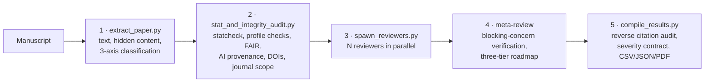

# academic-peer-review

[](https://github.com/LaBiOmicS/academic-peer-review/actions/workflows/ci.yml)
[](https://github.com/LaBiOmicS/academic-peer-review/releases)
[](LICENSE)
[](https://www.python.org)
[](https://labiomics.github.io/academic-peer-review/)

**English** · [Português](README.pt-BR.md) · [Español](README.es.md)

A plugin for **Claude Code** and **Antigravity (`agy`)** that produces an AI-assisted peer review of a scientific manuscript. A deterministic pre-review audit runs first. A panel of independent reviewer agents with distinct roles then writes the reviews, and an editorial meta-review synthesizes them with calibrated severity. The output is a set of Markdown, CSV and JSON files and a PDF report.

It serves two uses: a **draft for a referee or editor**, who verifies, edits and signs it, and a **review round for authors**, who can adapt their own manuscript proactively before submission. Either way, a human checks every point before acting on it.

---

## Contents

- [Overview](#overview)
- [Pipeline](#pipeline)
- [Reviewer panel](#reviewer-panel)
- [Severity calibration](#severity-calibration)
- [Deterministic audit](#deterministic-audit)
- [Manuscript classification](#manuscript-classification)
- [Security model](#security-model)
- [Installation](#installation)
- [Usage](#usage)
- [Parameters](#parameters)
- [Outputs](#outputs)
- [Limitations](#limitations)
- [Development](#development)
- [Citation](#citation)
- [License and authorship](#license-and-authorship)

---

## Overview

| | |
|---|---|
| **Hosts** | Claude Code (native subagents) · Antigravity CLI · headless subprocesses (`claude -p`, `agy -p`, `gemini -p`) |
| **Input formats** | PDF, DOCX, LaTeX, Markdown, plain text, reStructuredText; ODT, RTF, HTML and EPUB through pandoc |
| **Report language** | Same as the manuscript (English, Portuguese or Spanish) |
| **Panel size** | 3–8 reviewers (default 5), optionally on different models |
| **Classification** | 5 areas × 15 article types × 13 research approaches = 975 profiles |
| **External services** | OpenAlex, doi.org, arXiv, Europe PMC, Crossref (read-only, HTTPS) |
| **Runtime** | Python ≥ 3.10; dependencies declared inline (PEP 723) and resolved by `uv` |

## Pipeline



Steps 1, 2 and 5 are deterministic and covered by the test suite. Language models are used only in steps 3 and 4.

## Reviewer panel

Roles are filled in priority order and then shuffled across the Greek codenames (`alfa`, `beta`, `gamma`, …), so a codename does not reveal its role.

| Reviewers | Composition |
|---|---|
| 3 | red-team critic, author advocate, methodology & statistics auditor |
| 4 | + reproducibility, ethics & FAIR inspector |
| 5 (default) | + domain reviewer |
| 6–8 | + further domain reviewers |

- **Red-team critic**: looks for the flaw that would invalidate the main conclusion, along an attack axis drawn from a table specific to the area or article type.
- **Author advocate**: tests the likely critiques against what the manuscript already says and flags disproportionate or genre-mismatched requests.
- **Methodology & statistics auditor**: design, indicator validity, statistical inference.
- **Reproducibility inspector**: internal consistency, data and code availability, declarations, reporting guidelines.
- **Domain reviewer**: novelty, prior art, field-specific merit and journal fit.

Each reviewer receives a seed that selects its analytical lens and stance (*String Seed of Thought*). Reviewers do not see each other's reports. With 3 or 4 reviewers the panel has no domain reviewer.

**Mixed-model panels.** `panel_models` (e.g. `claude:opus,agy,claude:sonnet`) assigns a `runner:model` pair to each reviewer in turn. Reviewers on the same model share its blind spots, so the meta-review gives weight to agreement only when it comes from different models. The models used are recorded in `results.json`.

## Severity calibration

Each major concern carries a tier:

| Tier | Definition | Limit |
|---|---|---|
| **Blocking** | A stated conclusion does not stand without the change; the reviewer quotes it | ≤ 5 per report |
| **Essential** | Reporting, transparency and declarations at the standard of the article type | — |
| **Optional** | Scope extensions and new analyses the authors may decline with a one-line justification | — |

Before raising a concern, a reviewer searches the text for caveats the authors already wrote and checks the direction of any bias it alleges. For example, an incomplete final year undercounts rather than inflates. The assigned lens is treated as a hypothesis to test.

The meta-review does not count agreement between reviewers as evidence. Every candidate blocking concern goes through a verification table with these columns: conclusion at stake, the authors' existing treatment, direction of the bias, proportionate remedy and final tier. `compile_results.py` enforces the contract (tiers present, at most 5 blocking items, verification table and three-tier roadmap present) and reports violations as `SEVERITY CONTRACT NOT MET`. It also inserts the audit figures into the meta-review and warns when the prose contradicts them.

## Deterministic audit

| Module | Checks |
|---|---|
| `statcheck` | Recomputes p-values from reported *t*, *F*, *r*, χ² and *z*; flags inconsistencies, decision errors and fragile values |
| Profile checks | Reporting items for the article type and research approach (e.g. PRISMA, CONSORT, STROBE, ARRIVE, COREQ, BIBLIO), including whether a search string is in the text, an external protocol or the supplement |
| FAIR & reproducibility | Repositories and persistent identifiers, evasive availability statements, dependency locking, random seeds, RRIDs, catalogue numbers |
| Generative AI | Leftover chat artifacts, AI listed as author, presence of an AI-use statement |
| Citations | DOIs resolved against OpenAlex and doi.org; retractions; arXiv IDs against the arXiv API |
| Journal scope | Fit with the target journal's topics (curated profiles or OpenAlex Sources), formal requirements, desk-reject risk |
| Hidden content | Text invisible to human readers (white, microscopic or off-page PDF text, hidden DOCX runs, LaTeX/HTML/Markdown comments) |

## Manuscript classification

The manuscript is classified on three axes, which together select the reviewer rubric, the audit checks and the lens tables.

- **Area (5):** life & agricultural sciences, health, physical & earth sciences, engineering, humanities & social sciences.
- **Article type (15):** original research, systematic review, meta-analysis, umbrella review, scoping review, integrative review, narrative review, bibliometric review, guideline/consensus, case study, data paper, software paper, methods/protocol, theoretical essay, short communication.
- **Research approach (13):** clinical/interventional, diagnostic/prognostic, epidemiological/observational, field/ecological/agronomic, experimental/laboratory, computational/in silico, quantitative, qualitative, mixed methods, action/design science, documentary/archival, bibliometric/scientometric, theoretical/formal.

Article types that analyse metadata, such as bibliometric reviews, have their own lens and red-team tables and are not held to primary-study requirements (replicates, power, FDR, ethics approval). Transversal checks apply only when relevant: SAGER when the manuscript involves human or animal subjects, and TRIPOD+AI / CLAIM when it contains an AI model.

Classification is keyword-based. When the evidence for an axis is weak, the axis is marked `needs_confirmation` and the agent checks the title, abstract and methods, asking the user in interactive sessions. Axes passed explicitly are not re-evaluated.

## Security model

- Manuscript text is wrapped in `<UNTRUSTED_MANUSCRIPT_CONTENT>` and treated as data. Instructions embedded in it are never followed.
- Hidden text aimed at AI reviewers is redacted from the reviewers' copy and reported to the editor as a possible integrity case. It never decides the verdict.
- Invisible and bidirectional Unicode characters are removed. Exported CSV cells are protected against formula injection.
- Headless reviewers run with a sanitized environment (only the selected runner's credentials) and, by default, inside the runner's sandbox (`tool_permissions=sandboxed`).
- External requests are HTTPS-only, read-only and size-capped. XML responses with DTD or entity declarations are rejected.

## Installation

**Requirements:** Python ≥ 3.10, [`uv`](https://github.com/astral-sh/uv), and Claude Code or Antigravity CLI, installed and authenticated. Optional: `pandoc` with a LaTeX engine for the typeset PDF (ReportLab is used otherwise), and `pdftotext` (poppler-utils) for two-column PDFs.

### Claude Code

```text
/plugin marketplace add LaBiOmicS/academic-peer-review
/plugin install academic-peer-review@labiomics
```

### Installer script (Claude Code and Antigravity)

```bash
git clone https://github.com/LaBiOmicS/academic-peer-review.git
cd academic-peer-review
./install.sh
```

The script syncs the Python environment and registers the plugin in whichever CLIs are installed.

### Antigravity CLI

```bash
agy plugin validate ./academic-peer-review --strict
agy plugin install ./academic-peer-review
agy plugin enable academic-peer-review
```

## Usage

### Interactive

```text
/paper-review paper="./manuscript.pdf" target_journal="Bioinformatics" num_reviewers=5
```

A plain request also works, e.g. *"Run a blind peer review of ./manuscript.pdf for PLOS ONE"*. In Claude Code, use `/academic-peer-review:paper-review` if another plugin also provides a `paper-review` skill.

### Headless

```bash
SKILL=skills/paper-review
OUT=./out/my_paper

uv run $SKILL/scripts/extract_paper.py ./manuscript.pdf \
  --output-text $OUT/paper_text.txt --output-meta $OUT/paper_structure.json

uv run $SKILL/scripts/stat_and_integrity_audit.py \
  --paper-text-file $OUT/paper_text.txt --paper-meta $OUT/paper_structure.json \
  --output-md $OUT/pre_review_audit.md --output-json $OUT/pre_review_audit.json \
  --journal "Journal Name" --verify-citations

uv run $SKILL/scripts/spawn_reviewers.py \
  --paper-text-file $OUT/paper_text.txt --audit-file $OUT/pre_review_audit.md \
  --output-dir $OUT --skill-dir $SKILL --num-reviewers 5 \
  --runner auto --panel-models "claude:opus,agy,claude:sonnet"

# write $OUT/meta_review.md following $SKILL/prompts/metareview.md, then:
uv run $SKILL/scripts/compile_results.py --output-dir $OUT
```

`--prepare-only` writes the reviewer prompts and `panel_manifest.json` without launching subprocesses, for hosts that run reviewers as native subagents. Re-running `spawn_reviewers.py` without `--overwrite` keeps valid reviews and the panel's roles and seeds, and relaunches only the reviewers that failed.

### Cost

Each review costs one model call per reviewer plus the meta-review. As a reference, a manuscript of about 1,000 words with 3 reviewers on Claude Sonnet cost about US$ 1. For an article of about 9,000 words, each reviewer takes 3 to 5 minutes, and all of them work at the same time.

## Parameters

| Parameter | Default | Description |
|---|---|---|
| `paper` | — | Manuscript path (required) |
| `area`, `article_type`, `research_approach` | `auto` | Override any classification axis |
| `domain` | inferred | Specific field, e.g. `"soil microbiology"` |
| `target_journal` | `""` | Journal for the scope and desk-reject audit |
| `num_reviewers` | `5` | Panel size, 3–8 |
| `panel_models` | `""` | Comma-separated `runner[:model]` entries for a mixed-model panel |
| `alignment_critic` / `author_advocate` / `specialist_panel` | `true` | Include the red-team critic / author advocate / specialist auditors |
| `verify_citations` | `true` | Query OpenAlex and doi.org for DOIs and retractions |
| `execution_mode` | `auto` | `subagents` or `cli` (headless subprocesses) |
| `tool_permissions` | `sandboxed` | Headless only: `sandboxed`, `none` or `unsafe` |
| `overwrite` | `false` | Discard existing reviews and draw a new panel |

`compile_results.py --no-ai-disclosure` omits the AI-assistance notice from the PDF. Disclosure to the journal then remains the referee's responsibility.

## Outputs

| File | Content |
|---|---|
| `editorial_peer_review_report.pdf` | Consolidated report: meta-review, concerns matrix, audit, individual reviews. Wide tables are set on landscape pages |
| `meta_review.md` | Verdicts, common and unique concerns, blocking-concern verification, three-tier roadmap, decision |
| `author_letter.md` | Decision with the blocking and essential items only |
| `review_<codename>.md` | One report per reviewer |
| `pre_review_audit.md` / `.json` | Deterministic audit |
| `concerns_table.csv` / `concerns_matrix.json` | Concerns × reviewers, with severity tier and `major` / `minor` per reviewer |
| `results.json` | Verdicts, roles, runners and models, reverse citation audit, severity contract, audit hash |
| `consolidated_editorial_report.md` | Markdown source of the PDF |

## Limitations

- **Not a substitute for peer review.** The reports are drafts. Reviewers can misread a manuscript, and agreement between reviewers on the same model is not independent corroboration.
- **Confidentiality.** Uploading an unpublished manuscript to an AI service may breach the journal's peer-review policy (COPE, ICMJE and many publishers restrict it). Check before using the tool as an invited referee. Authors reviewing their own work before submission face no such restriction.
- **Keyword classification.** Unusual manuscripts can be misclassified. Low-confidence axes are flagged for confirmation, and any axis can be set explicitly.
- **Journal scope.** Only journals with a curated profile have verified requirements. For other journals, scope is estimated from OpenAlex topics and requirements are reported as typical, not verified.
- **Statistics.** `statcheck` only parses complete test expressions reported in APA-like form.

## Development

```bash
uv sync --all-extras
uv run pytest -q                       # test suite (network access is blocked in tests)
uvx ruff check skills tests            # lint
agy plugin validate . --strict         # manifest validation
```

```text
skills/paper-review/
├── SKILL.md                 # orchestration instructions for the host agent
├── prompts/                 # reviewer templates and meta-review prompt
├── scripts/                 # extraction, audit, panel, compilation, PDF
└── references/              # taxonomy and calibration guide
agents/peer-reviewer.md      # reviewer subagent definition
rules/AGENTS.md              # integrity, anonymity and security rules
site/                        # project page (GitHub Pages)
tests/                       # pytest suite
```

Changes are listed in [CHANGELOG.md](CHANGELOG.md).

## Citation

```bibtex
@software{menegidio_academic_peer_review,
  author  = {Menegidio, Fabiano Bezerra},
  title   = {academic-peer-review: AI-assisted academic peer review with deterministic audits},
  year    = {2026},
  version = {1.3.2},
  url     = {https://github.com/LaBiOmicS/academic-peer-review},
  note    = {LaBiOmicS, Universidade de Mogi das Cruzes}
}
```

## License and authorship

MIT License. Copyright © 2026 Fabiano Bezerra Menegidio.

Developed at the Laboratory of Bioinformatics and Omics Sciences (**LaBiOmicS**), Universidade de Mogi das Cruzes (**UMC**), Brazil. Contact: [fabianomenegidio@umc.br](mailto:fabianomenegidio@umc.br).
