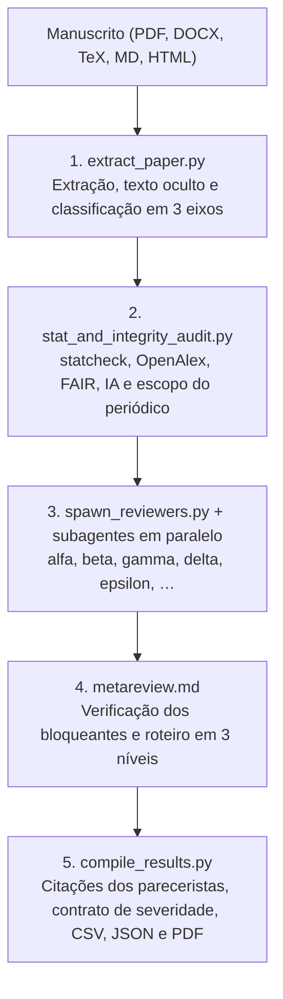

# academic-peer-review
## Revisão Acadêmica por Pares & Integridade Científica

[](https://github.com/LaBiOmicS/academic-peer-review/actions/workflows/ci.yml)
[](https://github.com/LaBiOmicS/academic-peer-review/releases)
[](https://labiomics.github.io/academic-peer-review/)
[](https://docs.anthropic.com/en/docs/claude-code)
[](#opção-b-instalação-direta-via-antigravity-cli)
[](LICENSE)
[](https://python.org)

**[Português](#versão-em-português) | [English](#english-version) | [Página do projeto / Project page](https://labiomics.github.io/academic-peer-review/)**

---

## Versão em Português

Plugin para **Claude Code (`claude`)** e **Gemini / Antigravity (`agy`)** que monta um painel de pareceristas independentes, identificados por codinomes gregos (`alfa`, `beta`, `gamma`, `delta`, …), para avaliar um manuscrito científico. O painel é precedido por uma auditoria determinística: recálculo estatístico (`statcheck`), verificação de DOIs e retratações no OpenAlex, dados FAIR, uso de IA generativa, texto oculto e aderência ao periódico-alvo. O resultado é uma metarrevisão editorial com roteiro de correções priorizado e um relatório em PDF.

Os pareceres são **rascunhos assistidos por IA**: um parecerista ou editor humano deve verificá-los, editá-los e assumir a responsabilidade por eles.

Desenvolvido no **LaBiOmicS / UMC** sob coordenação do **Prof. Dr. Fabiano Bezerra Menegidio**.

---

### Principais Funcionalidades

1. **Classificação em 3 eixos (5 áreas × 15 tipologias × 13 abordagens = 975 perfis)**:
   - **Eixo 1 — 5 Grandes Áreas (`--area`)**: Biológicas/Ômicas/Agrárias, Saúde/Clínica, Exatas e da Terra, Engenharias e Humanas/Sociais.
   - **Eixo 2 — 15 Tipologias de Artigo (`--article-type`)**: Artigo Original, Revisão Sistemática, Metanálise, Scoping Review, Revisão Integrativa, Revisão Narrativa, Revisão Bibliométrica, Diretriz Clínica/Consenso Delphi, Relato/Estudo de Caso, Data Paper, Software Paper, Protocolo, Ensaio Teórico e Comunicação Breve.
   - **Eixo 3 — 13 Abordagens de Pesquisa (`--research-approach`)**: Ensaio Clínico, Biomarcadores/Diagnóstico, Epidemiológico/Observacional, Campo/Ecológico/Agronômico, Bancada/Experimental, Computacional/In Silico, Quantitativo/Estatístico, Qualitativo, Métodos Mistos, DSR/Pesquisa-Ação, Documental/Histórico, Bibliométrico/Cienciométrico e Teórico-Formal.
   - Cada perfil gera uma microrrubrica própria e as checagens correspondentes da auditoria. Tipologias que analisam metadados (ex.: revisões bibliométricas) recebem lentes e eixos de crítica próprios e não são cobradas por padrões de estudo primário (réplicas, poder, FDR, aprovação ética).
   - **Confirmação quando incerta**: a classificação é por palavras-chave. Quando a evidência de um eixo é fraca, ele é marcado como `needs_confirmation`, e o agente confere o título, o resumo e os métodos antes de montar o painel (em sessão interativa, pergunta ao usuário). Os eixos passados explicitamente não são reavaliados.
   - **Diretrizes Transversais**: equidade de sexo/gênero (**SAGER**) e IA biomédica (**TRIPOD+AI / CONSORT-AI / CLAIM**), ativadas só quando o manuscrito tem sujeitos humanos/animais ou um modelo de IA.

2. **Painel de pareceristas com papéis distintos**:
   - Os papéis são preenchidos nesta ordem de prioridade e depois sorteados entre os codinomes, para que a letra não revele o papel:

     | Nº de pareceristas | Composição |
     |---|---|
     | 3 | crítico *red-team*, advogado do autor, auditor de métodos e estatística |
     | 4 | + auditor de reprodutibilidade, ética e FAIR |
     | 5 (padrão) | + parecerista de domínio |
     | 6 a 8 | + pareceristas de domínio adicionais |

   - Com 3 ou 4 pareceristas, o painel não tem parecerista de domínio. Use 5 ou mais quando a avaliação do mérito na área for importante.
   - Cada parecerista recebe uma semente própria, que define sua lente ou eixo de crítica e sua postura (*String Seed of Thought*).
   - **Painel com modelos misturados** (`panel_models`, ex.: `claude:opus,agy,claude:sonnet`): cada parecerista roda num par runner:modelo. Pareceristas no mesmo modelo compartilham os mesmos pontos cegos, então só a concordância entre modelos diferentes ganha algum peso.

3. **Calibração de severidade e proporcionalidade**:
   - Cada preocupação maior recebe um nível: **Bloqueante** (alguma conclusão publicada não se sustenta sem a correção), **Essencial** (relato e transparência) ou **Opcional** (ampliações de escopo, análises novas). São no máximo 5 bloqueantes por parecer.
   - Antes de levantar uma crítica, o parecerista procura no texto as ressalvas que os autores já fizeram e confere a direção do viés que aponta (ex.: um ano incompleto subestima a contagem, não a infla). A lente sorteada é uma hipótese a testar, não uma conclusão.
   - O **advogado do autor**, contrapeso do *red-team*, testa as críticas prováveis contra o manuscrito e aponta exigências desproporcionais ou importadas de outro gênero.
   - Na metarrevisão, a concordância entre pareceristas não conta como evidência. Cada bloqueante passa por uma tabela de verificação contra o texto, e o roteiro tem três níveis (Bloqueante, Essencial, Opcional).
   - O compilador confere esse contrato (níveis presentes, até 5 bloqueantes, tabela de verificação) e avisa com `SEVERITY CONTRACT NOT MET` quando ele é violado. Os números da auditoria entram na metarrevisão direto do arquivo de auditoria, e o compilador avisa quando a metarrevisão os contradiz.

4. **Voz profissional e transparência sobre IA (PT / EN / ES)**:
   - Os pareceres são redigidos no tom de um parecerista sênior, no idioma do manuscrito, sem frases de chatbot e sem expor prompts ou scripts internos.
   - O PDF final inclui uma **declaração de uso de IA** (`--no-ai-disclosure` a remove; a declaração à revista passa a ser responsabilidade do parecerista).
   - **Confidencialidade**: antes de enviar um manuscrito inédito a um serviço de IA, confirme que a política de revisão da revista permite (COPE, ICMJE e várias editoras restringem esse uso e exigem declaração).

5. **Auditoria determinística de dados FAIR e reprodutibilidade**:
   - Sinaliza declarações evasivas (*"dados disponíveis mediante solicitação"*).
   - Mapeia depósitos abertos (Zenodo, GitHub, OSF, Figshare, Dryad, NCBI SRA/GEO, PRIDE) e formatos reutilizáveis.
   - Verifica travamento de dependências (`requirements.txt`, `environment.yml`, Docker), sementes aleatórias, códigos de catálogo, RRIDs e sequências de *primers*.

6. **Auditoria de IA generativa (COPE / ICMJE / SciELO)**: resíduos de chat esquecidos no texto, coautoria atribuída a IA, declaração de uso de IA e densidade de chavões sintéticos.

7. **Proteção contra alucinações**:
   - **Âncora literal**: toda crítica cita o trecho exato do manuscrito.
   - **Checagem contra falsa omissão**: busca por sinônimos antes de afirmar que algo está ausente.
   - **Auditoria reversa de citações**: o compilador verifica ao vivo os DOIs citados pelos pareceristas no OpenAlex e no doi.org, e os identificadores arXiv na API do arXiv.

8. **Escopo do periódico e risco de *desk reject* (`--journal`)**: aderência temática ao periódico-alvo (perfis curados e OpenAlex Sources API, ignorando a lista de referências), requisitos formais comuns e periódicos alternativos quando o risco é alto.

9. **Segurança da informação**:
   - O texto do manuscrito é isolado em `<UNTRUSTED_MANUSCRIPT_CONTENT>` e tratado como dado, nunca como instrução.
   - Detecção de **conteúdo oculto** que tenta manipular a revisão (texto branco, microscópico ou fora da página em PDF; trechos ocultos em DOCX; comentários em LaTeX, HTML e Markdown). Tentativas de manipulação são denunciadas ao editor e não decidem o veredito.
   - Sanitização de caracteres Unicode invisíveis/bidirecionais, ambiente restrito para os subprocessos e proteção contra *CSV Formula Injection* nas matrizes exportadas.

---

### Tutorial de Instalação

#### Requisitos
- **Python**: versão 3.10 ou superior.
- **Agente**: Claude Code (`claude`) ou Antigravity CLI (`agy`), instalado e autenticado.
- **`uv`** (recomendado): cada script declara suas dependências (PEP 723) e o `uv run` as instala isoladamente. Sem elas, a detecção de texto oculto em PDF/DOCX não roda, e a auditoria registra a verificação como **incompleta**.
- **Utilitários opcionais**: `pandoc` (DOCX, LaTeX e HTML; também gera o PDF via LaTeX) e `pdftotext` (pacote `poppler-utils`). Sem LaTeX, o PDF é gerado com ReportLab.

#### Custo e tempo
Cada revisão consome tokens do modelo usado pelo agente: um parecer por parecerista, mais a metarrevisão. Como referência, uma revisão de um manuscrito curto (~1.000 palavras) com 3 pareceristas no Claude Sonnet custou cerca de **US$ 1** e levou poucos minutos; um artigo completo (~9.000 palavras) com 4 pareceristas leva de 3 a 5 minutos por parecerista, em paralelo. O custo cresce com o tamanho do manuscrito, o número de pareceristas (`num_reviewers`, de 3 a 8) e o modelo. `num_reviewers=3` reduz o custo, mas deixa o painel sem parecerista de domínio e sem auditor de reprodutibilidade.

#### Opção A: Instalação automatizada (recomendada)
O instalador verifica o `uv`, sincroniza as dependências e registra o plugin no Claude Code e no Antigravity CLI (o que estiver instalado):
```bash
git clone https://github.com/LaBiOmicS/academic-peer-review.git
cd academic-peer-review
./install.sh
```

No Claude Code, o plugin também pode ser instalado direto do GitHub:
```text
/plugin marketplace add LaBiOmicS/academic-peer-review
/plugin install academic-peer-review@labiomics
```

#### Opção B: Instalação direta via Antigravity CLI
```bash
agy plugin validate /caminho/para/academic-peer-review --strict
agy plugin install /caminho/para/academic-peer-review
agy plugin enable academic-peer-review
```

#### Opção C: Ambiente manual com `uv`
```bash
uv sync --all-extras
uv run skills/paper-review/scripts/stat_and_integrity_audit.py --help
```

---

### Tutorial de Uso



#### Modo 1: Uso interativo (Claude Code ou Antigravity)

Basta indicar o manuscrito e pedir a avaliação:

* **Artigo que você vai submeter (inglês)**:
  > *"Faça uma revisão cega por pares deste artigo que vamos submeter à PLOS ONE: `./manuscritos/salmonella_genomics.pdf`"*

* **Artigo recebido para parecer (português ou espanhol)**:
  > *"Recebi este artigo para emitir parecer para a revista Ecología Austral: `./revisoes/artigo.docx`. Faça a auditoria metodológica e gere o relatório em português."*

* **Comando da skill com parâmetros**:
  ```text
  /paper-review paper="./manuscritos/artigo_genomica.pdf" area="biologicas" target_journal="Bioinformatics" num_reviewers=5
  ```
  No Claude Code, use o nome qualificado `/academic-peer-review:paper-review` se outro plugin também tiver uma skill `paper-review`.

O agente coordenador executa:
1. Extração do texto, varredura de conteúdo oculto e classificação (com confirmação dos eixos quando a confiança é baixa).
2. Auditoria determinística: `statcheck`, checagens do perfil, FAIR, uso de IA, DOIs e retratações, escopo do periódico.
3. Disparo dos pareceristas em paralelo, cada um com seu papel, semente e lente.
4. Metarrevisão editorial com verificação dos bloqueantes contra o texto.
5. Compilação: auditoria reversa de citações, matriz de preocupações, carta aos autores e PDF.

#### Modo 2: Linha de comando (headless / automação)

```bash
SKILL_DIR="skills/paper-review"
OUT_DIR="./papers/artigo_exemplo"
mkdir -p "$OUT_DIR"

# 1. Extração do texto e classificação
uv run $SKILL_DIR/scripts/extract_paper.py "./artigo.pdf" \
  --output-text "$OUT_DIR/paper_text.txt" \
  --output-meta "$OUT_DIR/paper_structure.json"

# 2. Auditoria pré-revisão
uv run $SKILL_DIR/scripts/stat_and_integrity_audit.py \
  --paper-text-file "$OUT_DIR/paper_text.txt" \
  --output-json "$OUT_DIR/pre_review_audit.json" \
  --output-md "$OUT_DIR/pre_review_audit.md" \
  --paper-meta "$OUT_DIR/paper_structure.json" \
  --journal "Nome do Periódico" \
  --verify-citations

# 3. Preparação dos prompts dos pareceristas
uv run $SKILL_DIR/scripts/spawn_reviewers.py \
  --paper-text-file "$OUT_DIR/paper_text.txt" \
  --audit-file "$OUT_DIR/pre_review_audit.md" \
  --output-dir "$OUT_DIR" \
  --skill-dir "$SKILL_DIR" \
  --num-reviewers 5 \
  --prepare-only

# 3b. (Opcional) Rodar os pareceristas como subprocessos headless em vez de subagentes:
#     troque --prepare-only por --runner auto|agy|gemini|claude
#     e, para um painel com modelos misturados, --panel-models "claude:opus,agy,claude:sonnet"

# 4. Escrever meta_review.md (o agente faz isso no Modo 1) e compilar
uv run $SKILL_DIR/scripts/compile_results.py --output-dir "$OUT_DIR"
# Opcional: --no-ai-disclosure remove do PDF o aviso de revisão assistida por IA
```

---

### Artefatos Gerados

| Arquivo | Descrição |
|---|---|
| `editorial_peer_review_report.pdf` | Relatório consolidado: metarrevisão, matriz de preocupações, auditoria e pareceres. |
| `meta_review.md` | Metarrevisão editorial: vereditos, preocupações comuns e únicas, verificação dos bloqueantes, roteiro em 3 níveis e veredito. |
| `author_letter.md` | Carta curta aos autores com a decisão e os itens bloqueantes e essenciais. |
| `review_<codinome>.md` | Um parecer por parecerista (`review_alfa.md`, `review_beta.md`, …). O papel de cada codinome é sorteado e fica registrado em `results.json`. |
| `pre_review_audit.md` / `.json` | Auditoria determinística (`statcheck`, checagens do perfil, FAIR, IA, DOIs, escopo, conteúdo oculto). |
| `concerns_table.csv` / `concerns_matrix.json` | Matriz de preocupações: nível de severidade e, por parecerista, crítica maior (`major`) ou menção de passagem (`minor`). |
| `consolidated_editorial_report.md` | Versão Markdown do relatório consolidado. |
| `results.json` | Metadados, vereditos, papéis e modelos dos pareceristas, auditoria reversa de citações e contrato de severidade. |

---

### Estrutura do Pacote

```text
academic-peer-review/
├── install.sh                         # Instalador (Claude Code e Antigravity)
├── pyproject.toml / uv.lock           # Dependências (PEP 621) e lockfile
├── plugin.json                        # Manifesto do plugin para Antigravity
├── .claude-plugin/
│   ├── plugin.json                    # Manifesto do plugin para Claude Code
│   └── marketplace.json               # Marketplace "labiomics"
├── agents/peer-reviewer.md            # Subagente parecerista
├── rules/AGENTS.md                    # Regras de integridade, anonimato e segurança
├── site/                              # Página do projeto (GitHub Pages)
├── tests/                             # Testes (pytest)
└── skills/paper-review/
    ├── SKILL.md                       # Instruções da skill para o agente
    ├── prompts/
    │   ├── reviewer.md                          # Parecerista de domínio
    │   ├── reviewer_alignment_forum.md          # Crítico red-team
    │   ├── reviewer_author_advocate.md          # Advogado do autor
    │   ├── reviewer_methodology_stats.md        # Auditor de métodos e estatística
    │   ├── reviewer_reproducibility_integrity.md # Auditor de reprodutibilidade, ética e FAIR
    │   └── metareview.md                        # Metarrevisão editorial
    ├── scripts/
    │   ├── area_profiles.py           # Matriz de 975 perfis, microrrubricas, lentes e eixos
    │   ├── extract_paper.py           # Extração de PDF, DOCX, TeX, HTML e Markdown
    │   ├── hidden_content.py          # Detecção de conteúdo oculto
    │   ├── stat_and_integrity_audit.py # statcheck, checagens do perfil, FAIR e IA
    │   ├── journal_scope.py           # Escopo do periódico e risco de desk reject
    │   ├── openalex_lookup.py         # DOIs e retratações (OpenAlex e doi.org)
    │   ├── arxiv_lookup.py            # Verificação de identificadores arXiv
    │   ├── literature_search.py       # Busca em OpenAlex, PubMed, Crossref e arXiv
    │   ├── arxiv_search.py            # Busca rápida no arXiv
    │   ├── spawn_reviewers.py         # Montagem do painel e execução headless
    │   ├── compile_results.py         # Compilação, auditoria reversa e contrato de severidade
    │   └── generate_pdf_report.py     # Relatório em PDF (pandoc/LaTeX ou ReportLab)
    └── references/panel_and_audit_guide.md # Taxonomia e calibração
```

---

## English Version

Plugin for **Claude Code (`claude`)** and **Gemini / Antigravity (`agy`)** that convenes a panel of independent reviewers under Greek letter codenames (`alfa`, `beta`, `gamma`, `delta`, …) to evaluate a scientific manuscript. The panel is preceded by a deterministic audit: statistical recalculation (`statcheck`), DOI and retraction checks against OpenAlex, FAIR data, generative-AI provenance, hidden content and target-journal fit. The output is an editorial meta-review with a prioritized revision roadmap and a PDF report.

Reports are **AI-assisted drafts**: a human referee or editor must verify, edit and take responsibility for them.

Developed at **LaBiOmicS / UMC** under the leadership of **Prof. Dr. Fabiano Bezerra Menegidio**.

---

### Key Capabilities

1. **3-axis classification (5 areas × 15 article types × 13 research approaches = 975 profiles)**: each profile gets its own micro-rubric and audit checks. Article types that analyse metadata (e.g. bibliometric reviews) get their own lenses and red-team axes and are not held to primary-study standards (replicates, power, FDR, ethics approval). When the evidence for an axis is weak, it is flagged `needs_confirmation` and the agent checks the title, abstract and methods before building the panel. Transversal guidelines: **SAGER** and **TRIPOD+AI / CONSORT-AI / CLAIM**, triggered only when the paper has human/animal subjects or an AI model.
2. **A panel with distinct roles**, filled in priority order and then shuffled across codenames:

   | Reviewers | Panel |
   |---|---|
   | 3 | red-team critic, author advocate, methodology & statistics auditor |
   | 4 | + reproducibility, ethics & FAIR inspector |
   | 5 (default) | + domain reviewer |
   | 6–8 | + further domain reviewers |

   With 3 or 4 reviewers the panel has no domain reviewer; use 5 or more when field-specific merit matters. Each reviewer gets its own seed, which sets its lens or axis and stance. **Mixed-model panels** (`panel_models`, e.g. `claude:opus,agy,claude:sonnet`) give each reviewer its own runner:model pair, since reviewers on one model share its blind spots.
3. **Severity calibration & proportionality**: every major concern is **Blocking** (a stated conclusion fails without the fix), **Essential** (reporting and transparency) or **Optional** (scope expansions, new analyses), with at most 5 blocking concerns per report. Reviewers look for the caveats the authors already wrote and check the direction of every bias they allege. The **author advocate** tests likely critiques against the text. The meta-review does not count agreement as evidence, verifies every blocking concern against the manuscript, and uses a three-tier roadmap. The compiler checks this contract (`SEVERITY CONTRACT NOT MET`) and warns when the meta-review contradicts the audit figures.
4. **Professional referee voice & AI-assistance transparency (EN / PT / ES)**: reports are written in the manuscript's language without chatbot phrasing; the PDF carries an **AI-assistance disclosure** by default (`--no-ai-disclosure` omits it). Before uploading an unpublished manuscript to an AI service, confirm that the journal's peer-review policy allows it.
5. **FAIR & reproducibility audit**: evasive *"available upon request"* statements, open repositories and reusable formats, dependency locking, random seeds, catalogue numbers, RRIDs and primer sequences.
6. **Generative AI provenance audit (COPE / ICMJE / SciELO)**: leftover chat artifacts, AI co-authorship, AI-use statements and synthetic-phrasing density.
7. **Anti-hallucination guardrails**: verbatim anchoring of every criticism, negative-search grounding before claiming an omission, and live reverse checking of the DOIs (OpenAlex and doi.org) and arXiv IDs cited by reviewers.
8. **Target journal scope & desk-reject risk (`--journal`)**: thematic fit from curated profiles and the OpenAlex Sources API (ignoring the reference list), common formal requirements, and alternative journals when the risk is high.
9. **Information security**: manuscript text isolated in `<UNTRUSTED_MANUSCRIPT_CONTENT>` and treated as data; detection of **hidden content** aimed at manipulating the review (white, microscopic or off-page PDF text, hidden DOCX runs, LaTeX/HTML/Markdown comments), reported to the editor without deciding the verdict; Unicode sanitization, a restricted environment for subprocesses and CSV formula-injection protection.

---

### Installation

#### Prerequisites
- **Python** 3.10 or higher.
- **Agent**: Claude Code (`claude`) or Antigravity CLI (`agy`), installed and authenticated.
- **`uv`** (recommended): each script declares its dependencies (PEP 723) and `uv run` installs them in isolation. Without them the PDF/DOCX hidden-content checks cannot run, and the audit reports the scan as **incomplete**.
- **Optional tools**: `pandoc` (DOCX/LaTeX/HTML extraction and LaTeX PDF rendering) and `pdftotext` (`poppler-utils`). Without LaTeX, the PDF is rendered with ReportLab.

#### Cost and time
Each review spends tokens of the agent's model: one report per reviewer plus the meta-review. For reference, a short manuscript (~1,000 words) with 3 reviewers on Claude Sonnet cost about **US$ 1** and took a few minutes; a full article (~9,000 words) takes 3–5 minutes per reviewer, in parallel. `num_reviewers=3` keeps cost down but leaves the panel without a domain reviewer or reproducibility inspector.

#### Option A: Automated setup (recommended)
```bash
git clone https://github.com/LaBiOmicS/academic-peer-review.git
cd academic-peer-review
./install.sh
```

In Claude Code, the plugin can also be installed straight from GitHub:
```text
/plugin marketplace add LaBiOmicS/academic-peer-review
/plugin install academic-peer-review@labiomics
```

#### Option B: Antigravity CLI
```bash
agy plugin validate /path/to/academic-peer-review --strict
agy plugin install /path/to/academic-peer-review
agy plugin enable academic-peer-review
```

#### Option C: Manual setup with `uv`
```bash
uv sync --all-extras
uv run skills/paper-review/scripts/stat_and_integrity_audit.py --help
```

---

### Usage

#### Mode 1: Interactive (Claude Code or Antigravity)
* *"Please run a blind peer review of this manuscript we are submitting to PLOS ONE: `./papers/salmonella_genomics.pdf`"*
* *"I was asked to review this paper for Ecología Austral: `./reviews/paper.docx`. Run the methodological audit and write the report in Spanish."*
* Skill command:
  ```text
  /paper-review paper="./manuscript.pdf" area="biologicas" target_journal="Bioinformatics" num_reviewers=5
  ```
  In Claude Code, use `/academic-peer-review:paper-review` if another plugin also ships a `paper-review` skill.

#### Mode 2: Headless command line
```bash
SKILL_DIR="skills/paper-review"
OUT_DIR="./out/my_paper"
mkdir -p "$OUT_DIR"

uv run $SKILL_DIR/scripts/extract_paper.py "./manuscript.pdf" \
  --output-text "$OUT_DIR/paper_text.txt" --output-meta "$OUT_DIR/paper_structure.json"

uv run $SKILL_DIR/scripts/stat_and_integrity_audit.py \
  --paper-text-file "$OUT_DIR/paper_text.txt" \
  --output-md "$OUT_DIR/pre_review_audit.md" --output-json "$OUT_DIR/pre_review_audit.json" \
  --paper-meta "$OUT_DIR/paper_structure.json" --journal "Journal Name" --verify-citations

uv run $SKILL_DIR/scripts/spawn_reviewers.py \
  --paper-text-file "$OUT_DIR/paper_text.txt" --audit-file "$OUT_DIR/pre_review_audit.md" \
  --output-dir "$OUT_DIR" --skill-dir "$SKILL_DIR" --num-reviewers 5 --prepare-only
# Headless reviewers: replace --prepare-only with --runner auto|agy|gemini|claude
# (and --panel-models "claude:opus,agy,claude:sonnet" for a mixed-model panel)

# Write meta_review.md (the agent does this in Mode 1), then compile
uv run $SKILL_DIR/scripts/compile_results.py --output-dir "$OUT_DIR"
```

---

### Generated Artifacts

| File | Description |
|---|---|
| `editorial_peer_review_report.pdf` | Consolidated report: meta-review, concerns matrix, audit and referee reports. |
| `meta_review.md` | Editorial meta-review: verdicts, common and unique concerns, blocking-concern verification, three-tier roadmap and decision. |
| `author_letter.md` | Short letter to the authors with the decision and the blocking and essential items. |
| `review_<codename>.md` | One report per reviewer (`review_alfa.md`, `review_beta.md`, …). Roles are shuffled across codenames and recorded in `results.json`. |
| `pre_review_audit.md` / `.json` | Deterministic audit (`statcheck`, profile checks, FAIR, AI, DOIs, scope, hidden content). |
| `concerns_table.csv` / `concerns_matrix.json` | Concerns matrix: severity tier and, per reviewer, `major` concern or `minor` passing mention. |
| `consolidated_editorial_report.md` | Markdown version of the consolidated report. |
| `results.json` | Metadata, verdicts, reviewer roles and models, reverse citation audit and severity contract. |

---

## Autoria & Instituição / Author & Affiliation

**Prof. Dr. Fabiano Bezerra Menegidio**  
Laboratório de Bioinformática e Ciências Ômicas (**LaBiOmicS**)  
Universidade de Mogi das Cruzes (**UMC**)  
Contato / Contact: [fabianomenegidio@umc.br](mailto:fabianomenegidio@umc.br)

## Licença / License

MIT License — Copyright (c) 2026 Prof. Dr. Fabiano Bezerra Menegidio (LaBiOmicS / UMC).
