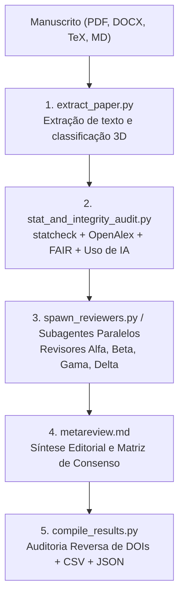

# academic-peer-review 
## Revisão Acadêmica por Pares & Integridade Científica

[](https://github.com/google-deepmind)
[](https://anthropic.com)
[](LICENSE)
[](https://python.org)
[](https://github.com/astral-sh/uv)

**[Português](#versão-em-português) | [English](#english-version)**

---

## Versão em Português

Plugin oficial multiplataforma para **Gemini / Antigravity (`agy`)** e **Anthropic Claude Code (`claude`)** voltado para revisão acadêmica por pares independente, comitês de múltiplos revisores especializados sob codinomes gregos (`Alfa`, `Beta`, `Gama`, `Delta`, …), classificação tridimensional (**5 Grandes Áreas × 15 Tipologias de Artigo × 12 Abordagens de Pesquisa = 900 perfis**), auditoria estatística determinística (`statcheck`), integridade de dados FAIR, proveniência de IA generativa e síntese editorial com relatório oficial em PDF.

Desenvolvido no **LaBiOmicS / UMC** sob coordenação do **Prof. Dr. Fabiano Bezerra Menegidio**.

---

### Principais Funcionalidades

1. **Classificação Tridimensional Inteligente (3 Eixos)**:
   - **Eixo 1 — 5 Grandes Áreas (`--area`)**: Biológicas/Ômicas/Agrárias, Saúde/Clínica, Exatas e da Terra, Engenharias e Humanas/Sociais.
   - **Eixo 2 — 15 Tipologias de Artigo (`--article-type`)**: Artigo Original, Revisão Sistemática, Metanálise, Scoping Review, Revisão Integrativa, Revisão Narrativa, Bibliometria, Diretriz Clínica/Consenso Delphi, Relato/Estudo de Caso, Data Paper, Software Paper, Protocolo, Ensaio Teórico e Comunicação Breve.
   - **Eixo 3 — 12 Abordagens de Pesquisa (`--research-approach`)**: Ensaio Clínico, Biomarcadores/Diagnóstico, Epidemiológico/Observacional, Campo/Ecológico/Agronômico, Bancada/Experimental, Computacional/In Silico, Quantitativo/Estatístico, Qualitativo, Métodos Mistos, DSR/Pesquisa-Ação, Documental/Histórico e Teórico-Formal.
   - **Confirmação quando incerta**: a classificação é por palavras-chave. Quando a evidência de um eixo é fraca, ele é marcado como `needs_confirmation`, e o agente confere o título, o resumo e os métodos antes de montar o painel (em sessão interativa, pergunta ao usuário). Os eixos passados explicitamente não são reavaliados.
   - **Diretrizes Transversais**: Checagem automática de equidade de sexo/gênero (**SAGER**) e IA biomédica (**TRIPOD+AI / CONSORT-AI / CLAIM**).

2. **Voz Profissional de Parecerista & Transparência sobre IA (Trilíngue: PT / EN / ES)**:
   - Os pareceres são redigidos no tom de um parecerista acadêmico sênior, sem frases de chatbot (*"Como uma IA..."*) e sem expor prompts ou scripts internos.
   - Os relatórios são **rascunhos assistidos por IA**: devem ser verificados, editados e assinados por um parecerista ou editor humano. O PDF final inclui uma **declaração de uso de IA**.
   - **Confidencialidade**: antes de enviar um manuscrito inédito a um serviço de IA, confirme que a política de revisão da revista permite (COPE, ICMJE e várias editoras restringem esse uso e exigem declaração).
   - **Alinhamento Linguístico Nativo**: O parecer e a meta-revisão são redigidos no mesmo idioma do manuscrito (Português, Inglês ou Espanhol).

3. **Auditoria Determinística de Dados FAIR & Reprodutibilidade**:
   - **Veto a Declarações Evasivas**: Detecta e sinaliza expressões como *"dados disponíveis mediante solicitação razoável"* (*available upon reasonable request*).
   - **Repositórios e PIDs**: Mapeia depósitos abertos (Zenodo, GitHub, OSF, Figshare, Dryad, NCBI SRA/GEO, PRIDE) e formatos reutilizáveis (CSV, TSV, FASTQ, BAM, VCF, HDF5/AnnData).
   - **Reprodutibilidade Computacional**: Verifica travamento de dependências (`requirements.txt`, `environment.yml`, Docker) e fixação de sementes aleatórias (*random seeds*).
   - **Especificidade de Bancada**: Checa códigos de catálogo de reagentes, RRIDs de anticorpos/linhagens e sequências de *primers*.

4. **Auditoria Forense de IA Generativa (COPE / ICMJE / SciELO)**:
   - Detecta resíduos crus de chat esquecidos no texto (*"como modelo de linguagem...", "certamente, aqui está o resumo..."*).
   - Veta coautoria atribuída a IAs generativas (`ChatGPT (Autor)`).
   - Valida seções de transparência e mede a densidade de chavões sintéticos (*tells*).

5. **Blindagem Ativa Contra Alucinações**:
   - **Âncora de Citação Literal (*Verbatim Anchor*)**: Obriga os pareceristas a citarem trechos literais exatos ao apontarem falhas metodológicas ou conceituais.
   - **Dupla Checagem contra Falsa Omissão (*Negative-Search Grounding*)**: Força varredura exaustiva por sinônimos antes de acusar que um tópico está ausente no manuscrito.
   - **Auditoria Reversa de Citações no OpenAlex**: O compilador verifica ao vivo se os DOIs citados pelos próprios pareceristas são reais ou alucinados. DOIs ausentes do OpenAlex (comum em preprints recentes) são confirmados no registro do doi.org antes de serem tratados como inexistentes.

6. **Validação de Escopo da Revista & Risco de Desk-Reject (`--journal`)**:
   - **Aderência a Aims & Scope**: Avalia a aderência temática e o nível de novidade conceitual/técnica frente ao perfil do periódico pretendido (via base de conhecimento curada e OpenAlex Sources API ao vivo).
   - **Prevenção Ativa de Desk-Reject**: Mapeia vícios de rejeição sumária de mesa (ex.: aplicação rotineira de software em revistas que exigem método novo, ou estudos empíricos em periódicos exclusivos de revisão/benchmark).
   - **Conformidade de Diretrizes do Autor**: Alerta sobre limites de palavras/figuras e seções obrigatórias (*Data Availability*, repositório aberto de código, registro de ensaio clínico).
   - **Recomendação de Periódicos Alternativos (*Cascading Journals*)**: Sugere 2 a 3 revistas com escopo mais aderente caso haja descompasso editorial.

7. **Segurança da Informação e Defesa Cibernética**:
   - Defesa ativa contra *Indirect Prompt Injection* (texto oculto em LaTeX/CSS e comandos maliciosos embutidos).
   - Sanitização de caracteres Unicode invisíveis/bidirecionais e isolamento estrito em `<UNTRUSTED_MANUSCRIPT_CONTENT>`.
   - Proteção contra OWASP *CSV Formula Injection* nas matrizes exportadas.

---

### Tutorial de Instalação

#### Requisitos
- **Python**: Versão 3.10 ou superior.
- **Agente**: Antigravity CLI (`agy`) ou Claude Code (`claude`), instalado e autenticado.
- **`uv`** (recomendado): cada script declara suas dependências (PEP 723) e o `uv run` as instala isoladamente. Sem elas, a detecção de texto oculto em PDF/DOCX não roda, e a auditoria registra a verificação como **incompleta**.
- **Utilitários Opcionais de Extração**:
  - `pandoc` (recomendado para DOCX, LaTeX e HTML).
  - `pdftotext` (pacote `poppler-utils`, para extração otimizada de PDFs). O extrator compara o resultado com o do `pypdf` e fica com o texto que tiver menos palavras coladas; o `pdftotext` roda em modo de leitura, que preserva a ordem das colunas.

#### Custo e tempo
Cada revisão consome tokens do modelo usado pelo agente: um parecer por parecerista, mais a metarrevisão. Como referência, uma revisão de um manuscrito curto (~1.000 palavras) com 3 pareceristas no Claude Sonnet custou cerca de **US$ 1** e levou poucos minutos. O custo cresce com o tamanho do manuscrito, o número de pareceristas (`num_reviewers`, de 3 a 8) e o modelo escolhido. Para reduzir, use `num_reviewers=3`.

#### Opção A: Instalação Automatizada com uv (Recomendada)
O instalador automatizado verifica o `uv`, sincroniza as dependências em ambiente isolado (pypdf, python-docx, ReportLab) e registra o plugin no Antigravity CLI e no Claude Code:
```bash
git clone https://github.com/LaBiOmicS/academic-peer-review.git
cd academic-peer-review
./install.sh
```

No Claude Code, o plugin também pode ser instalado direto do GitHub:
```text
/plugin marketplace add LaBiOmicS/academic-peer-review
/plugin install academic-peer-review@labiomics
```

#### Opção B: Instalação Direta via Antigravity CLI
```bash
# Validar e instalar diretamente a pasta do plugin
agy plugin install /caminho/para/academic-peer-review
agy plugin enable academic-peer-review
```

#### Opção C: Instalação Manual e Sincronização via `uv` (Astral)
```bash
# Sincroniza ambiente virtual e dependências (extração de PDF/DOCX e ReportLab)
uv sync --all-extras

# Executa scripts diretamente em ambiente isolado
uv run skills/paper-review/scripts/stat_and_integrity_audit.py --help
```

---

### Tutorial de Uso



#### Modo 1: Uso Interativo via Chat (Antigravity CLI ou IDE)

Esta é a forma mais prática e natural. Basta abrir o chat da Antigravity, anexar o manuscrito e solicitar a avaliação:

* **Exemplo 1 — Artigo que você vai submeter a uma revista internacional (Inglês)**:
  > *"Por favor, faça uma revisão cega por pares deste artigo que vamos submeter: `./manuscritos/salmonella_genomics.pdf`"*
  *(O plugin detectará o idioma inglês e emitirá os pareceres e a síntese editorial em inglês acadêmico formal para Nature/Elsevier).*

* **Exemplo 2 — Artigo recebido para você emitir parecer como revisor (Português/Espanhol)**:
  > *"Recebi este artigo para emitir parecer para a revista SciELO: `./revisoes/artigo_parasitologia.docx`. Faça a auditoria metodológica, de dados FAIR e gere o relatório do revisor em português."*

* **Exemplo 3 — Comando direto da skill com parâmetros customizados**:
  ```text
  /paper-review paper="./manuscritos/artigo_genomica.pdf" area="biologicas" num_reviewers=4
  ```
  No Claude Code, use o nome qualificado `/academic-peer-review:paper-review` se outro plugin também tiver uma skill `paper-review`.

O agente coordenador executará automaticamente:
1. Extração do texto completo e sanitização contra injeções de prompt (*Indirect Prompt Injection*).
   - Se a classificação vier com confiança baixa, confirmação dos eixos pelo resumo e pelos métodos (com uma pergunta ao usuário, em sessão interativa).
2. Pré-diagnóstico estatístico determinístico (`statcheck`), auditoria FAIR de repositórios/código, proveniência de IA e checagem de retratações na OpenAlex.
3. Disparo paralelo de 4 pareceristas independentes (`Alfa`, `Beta`, `Gama`, `Delta`) com sementes e lentes distintas.
4. Compilação dos pareceres, validação reversa de citações e geração da **Metarrevisão Editorial** com matriz de preocupações priorizadas.

---

#### Modo 2: Uso em Linha de Comando (Modo Headless / Automação)

Você pode executar o fluxo completo diretamente no terminal via scripts Python padrão:

```bash
# Definir diretório de trabalho e skill
SKILL_DIR="skills/paper-review"
OUT_DIR="./papers/artigo_exemplo"
mkdir -p "$OUT_DIR"

# 1. Extração do texto e classificação tridimensional
uv run $SKILL_DIR/scripts/extract_paper.py \
  "./artigo.pdf" \
  --output-text "$OUT_DIR/paper_text.txt" \
  --output-meta "$OUT_DIR/paper_structure.json" \
  --area auto \
  --article-type auto \
  --research-approach auto

# 2. Auditoria pré-revisão (Estatística, Citações OpenAlex, FAIR e Proveniência de IA)
uv run $SKILL_DIR/scripts/stat_and_integrity_audit.py \
  --paper-text-file "$OUT_DIR/paper_text.txt" \
  --output-json "$OUT_DIR/pre_review_audit.json" \
  --output-md "$OUT_DIR/pre_review_audit.md" \
  --verify-citations

# 3. Preparação dos prompts dos pareceristas independentes
uv run $SKILL_DIR/scripts/spawn_reviewers.py \
  --paper-text-file "$OUT_DIR/paper_text.txt" \
  --audit-file "$OUT_DIR/pre_review_audit.md" \
  --output-dir "$OUT_DIR" \
  --skill-dir "$SKILL_DIR" \
  --num-reviewers 4 \
  --prepare-only

# 3b. (Opcional) Executar os pareceristas como subprocessos headless em vez de subagentes:
#     troque --prepare-only por --runner auto|agy|gemini|claude

# 4. Compilação dos pareceres, auditoria reversa de citações e tabela de preocupações
uv run $SKILL_DIR/scripts/compile_results.py \
  --output-dir "$OUT_DIR"
# Opcional: --no-ai-disclosure remove do PDF o aviso de revisão assistida por IA
```

---

### Artefatos Gerados

Após a conclusão da revisão, os seguintes arquivos estruturados estarão disponíveis no diretório de saída:

| Arquivo | Descrição |
|---|---|
| `editorial_peer_review_report.pdf` | **Relatório Consolidado Oficial em PDF** diagramado em padrão de publicação (Editorial + Pareceres Cegos + Matriz + Diagnóstico). |
| `consolidated_editorial_report.md` | Documento Markdown consolidado completo com metadados e frontmatter. |
| `meta_review.md` | Parecer editorial conclusivo (Consenso, Divergências e Roteiro Prioritário de Correções). |
| `pre_review_audit.md` | Diagnóstico determinístico (`statcheck`, integridade FAIR, proveniência de IA e DOIs). |
| `concerns_table.csv` | Matriz booleana tabular de preocupações levantadas por revisor (pronta para Excel/R/Pandas). |
| `review_alfa.md` | Parecer detalhado do Revisor Alfa (Metodologia e Estatística). |
| `review_beta.md` | Parecer detalhado do Revisor Beta (Reprodutibilidade, Ética e FAIR). |
| `review_gamma.md` | Parecer detalhado do Revisor Gama (Crítica Red-Team Epistêmica). |
| `review_delta.md` | Parecer detalhado do Revisor Delta (Especialista da Área Temática). |
| `results.json` | Pacote consolidado em JSON contendo metadados, vereditos e auditoria reversa de citações. |

---

### Estrutura do Pacote

```text
academic-peer-review/
├── pyproject.toml                                  # Configuração PEP 621 e suporte nativo a uv
├── uv.lock                                         # Lockfile determinístico de dependências
├── plugin.json                                     # Manifesto do plugin para Antigravity (v1.0.0)
├── .claude-plugin/
│   ├── plugin.json                                 # Manifesto do plugin para Claude Code
│   └── marketplace.json                            # Marketplace local "labiomics" (instalação no Claude Code)
├── assets/
│   ├── logo.jpg                                    # Logotipo oficial LaBiOmicS / UMC
│   └── logo.svg                                    # Ícone vetorial SVG
├── agents/
│   └── peer-reviewer.md                            # Definição do subagente parecerista autônomo
├── rules/
│   └── AGENTS.md                                   # Regras mandatórias de integridade, anonimato e segurança
└── skills/
    └── paper-review/
        ├── SKILL.md                                # Documentação técnica da skill para agentes
        ├── prompts/
        │   ├── reviewer.md                         # Revisor Especialista de Domínio (com âncora literal)
        │   ├── reviewer_alignment_forum.md         # Crítico Red-Team Epistêmico
        │   ├── reviewer_methodology_stats.md       # Auditor Metodológico e Estatístico
        │   ├── reviewer_reproducibility_integrity.md # Auditor de Reprodutibilidade, Ética e FAIR
        │   └── metareview.md                       # Síntese Editorial e Matriz de Decisão
        ├── scripts/
        │   ├── area_profiles.py                    # Matriz 3D (900 perfis), microrrubricas e scanner AppSec
        │   ├── extract_paper.py                    # Extrator de PDFs, DOCX, TeX com defesas sandboxed
        │   ├── journal_scope.py                    # Auditor de aderência ao escopo da revista e risco de desk-reject
        │   ├── openalex_lookup.py                  # Consulta de DOIs em lote no OpenAlex (citações e retratações)
        │   ├── stat_and_integrity_audit.py         # Auditor estatístico (statcheck), OpenAlex, FAIR e IA
        │   ├── literature_search.py                # Busca multi-base HTTPS (OpenAlex, PubMed, Crossref, arXiv)
        │   ├── arxiv_search.py                     # Busca rápida via arXiv API
        │   ├── spawn_reviewers.py                  # Orquestrador paralelo seguro dos revisores
        │   ├── compile_results.py                  # Compilador com auditoria reversa de citações e proteção CSV
        │   └── generate_pdf_report.py              # Gerador do relatório oficial em PDF (Pandoc/ReportLab)
        └── references/
            └── panel_and_audit_guide.md            # Manual de taxonomia e calibração metodológica
```

---

## English Version

Official multi-platform plugin for **Google Gemini / Antigravity (`agy`)** and **Anthropic Claude Code (`claude`)** for multi-reviewer independent academic peer review, specialized reviewer panels under Greek letter codenames (`Alfa`, `Beta`, `Gamma`, `Delta`, …), 3-axis classification (**5 Major Areas × 15 Article Types × 12 Research Approaches = 900 profiles**), deterministic statistical auditing (`statcheck`), FAIR data integrity, generative AI provenance auditing, and editorial meta-review synthesis with publication-grade PDF report generation.

Developed at **LaBiOmicS / UMC** under the leadership of **Prof. Dr. Fabiano Bezerra Menegidio**.

---

### Key Capabilities

1. **3-Axis Composable Matrix**:
   - Classifies manuscripts across **5 Major Scientific Areas**, **15 Academic Article Types**, and **12 Research Approaches**, generating targeted (~12-line) micro-rubrics without polluting the prompt context.
   - Classification is keyword-based. When the evidence for an axis is weak, the axis is flagged `needs_confirmation` and the agent checks the title, abstract and methods before building the panel (asking the user in interactive sessions). Axes set explicitly are not re-evaluated.
2. **Professional Referee Voice & AI-Assistance Transparency (Trilingual: EN / PT / ES)**:
   - Reports use an authoritative academic referee voice in the manuscript's language (English, Portuguese, or Spanish), without chatbot phrasing or internal tool names.
   - Reports are **AI-assisted drafts** that a human referee or editor must verify and sign off on; the final PDF carries an **AI-assistance disclosure** by default (`compile_results.py --no-ai-disclosure` omits it; disclosure to the journal then remains the referee's responsibility).
   - **Confidentiality**: before uploading an unpublished manuscript to an AI service, confirm that the journal's peer-review policy allows it (COPE, ICMJE and many publishers restrict this and require disclosure).
3. **Pragmatic FAIR & Reproducibility Audit**:
   - Detects and flags evasive *"data available upon request"* statements.
   - Audits open repositories (Zenodo, GitHub, OSF, GEO/SRA), software dependency manifests (`requirements.txt`, `environment.yml`, Docker), and random seeds.
4. **Anti-Hallucination Guardrails**:
   - Enforces **Verbatim Anchoring** (mandatory direct quotes for criticisms), **Negative-Search Grounding** (double-check before claiming an element is omitted), and **Reverse Citation Checking** via OpenAlex in `compile_results.py`. DOIs missing from OpenAlex (common for recent preprints) are confirmed against the doi.org registry before being treated as nonexistent.
5. **Generative AI Provenance Audit (COPE / ICMJE / SciELO Standards)**:
   - Detects uncleaned chat artifacts, flags improper AI co-authorship, and measures synthetic stylistic tell densities.
6. **Target Journal Scope & Desk-Reject Risk Audit (`--journal`)**:
   - Assesses thematic fit, conceptual novelty thresholds, and editorial audience alignment using a curated journal registry and live OpenAlex Sources API queries.
   - Detects classical desk-reject pitfalls (e.g., routine tool applications in algorithmic journals, unformatted submissions, missing prospective trial registrations).
   - Recommends 2-3 suitable alternative/cascading journals when scope misalignment is identified.

---

### Installation

#### Prerequisites
- **Python**: 3.10 or higher.
- **Agent**: Antigravity CLI (`agy`) or Claude Code (`claude`), installed and authenticated.
- **`uv`** (recommended): each script declares its dependencies (PEP 723) and `uv run` installs them in isolation. Without them the PDF/DOCX hidden-content checks cannot run, and the audit reports the scan as **incomplete**.
- **Optional Tools**: `pandoc` (for DOCX/LaTeX) and `pdftotext` (for fast PDF extraction). The extractor compares its output with `pypdf` and keeps the text with fewer run-together words; `pdftotext` runs in reading mode, which keeps two-column layouts in order.

#### Cost and time
Each review spends tokens of the agent's model: one report per reviewer plus the meta-review. For reference, reviewing a short manuscript (~1,000 words) with 3 reviewers on Claude Sonnet cost about **US$ 1** and took a few minutes. Cost grows with manuscript length, the number of reviewers (`num_reviewers`, 3 to 8) and the model. To keep it down, use `num_reviewers=3`.

#### Option A: One-Command Automated Setup with uv (Recommended)
The automated setup verifies `uv`, synchronizes dependencies in an isolated virtual environment (pypdf, python-docx, ReportLab), and registers the plugin in Antigravity and Claude Code:
```bash
git clone https://github.com/LaBiOmicS/academic-peer-review.git
cd academic-peer-review
./install.sh
```

In Claude Code, the plugin can also be installed straight from GitHub:
```text
/plugin marketplace add LaBiOmicS/academic-peer-review
/plugin install academic-peer-review@labiomics
```

#### Option B: Direct Antigravity CLI Installation
```bash
agy plugin install /path/to/academic-peer-review
agy plugin validate /path/to/academic-peer-review --strict
```

#### Option C: Manual Setup with `uv`
```bash
# Sync isolated environment with PDF/DOCX extraction and ReportLab extras
uv sync --all-extras

# Run any audit script directly in isolation
uv run skills/paper-review/scripts/stat_and_integrity_audit.py --help
```

---

### Usage Tutorial

#### Mode 1: Interactive Chat in Antigravity (IDE or CLI)
Simply attach your paper in the chat or reference its file path:

* **Example 1 — Submitting to an international journal (English)**:
  > *"Please conduct an authoritative blind peer review of this manuscript for submission: `./papers/salmonella_genomics.pdf`"*

* **Example 2 — Reviewing a manuscript in Portuguese or Spanish**:
  > *"Please evaluate this paper submitted to SciELO: `./reviews/parasitology.docx`. Provide a full methodological audit in Portuguese."*

* **Example 3 — Skill slash command with custom parameters**:
  ```text
  /paper-review paper="./manuscript.pdf" area="biologicas" num_reviewers=4
  ```
  In Claude Code, use the qualified name `/academic-peer-review:paper-review` if another plugin also ships a `paper-review` skill.

---

#### Mode 2: Headless Command-Line Workflow

```bash
SKILL_DIR="skills/paper-review"
OUT_DIR="./out/my_paper"
mkdir -p "$OUT_DIR"

# 1. Extract text and classify 3-axis taxonomy
uv run $SKILL_DIR/scripts/extract_paper.py "./manuscript.pdf" \
  --output-text "$OUT_DIR/paper_text.txt" --output-meta "$OUT_DIR/paper_structure.json"

# 2. Run deterministic pre-review audit (statcheck, OpenAlex, FAIR, and AI provenance)
uv run $SKILL_DIR/scripts/stat_and_integrity_audit.py \
  --paper-text-file "$OUT_DIR/paper_text.txt" \
  --output-md "$OUT_DIR/pre_review_audit.md" \
  --output-json "$OUT_DIR/pre_review_audit.json" \
  --verify-citations

# 3. Prepare independent reviewer prompts
uv run $SKILL_DIR/scripts/spawn_reviewers.py \
  --paper-text-file "$OUT_DIR/paper_text.txt" \
  --audit-file "$OUT_DIR/pre_review_audit.md" \
  --output-dir "$OUT_DIR" --skill-dir "$SKILL_DIR" \
  --num-reviewers 4 --prepare-only

# 3b. (Optional) Run the reviewers as headless subprocesses instead of subagents:
#     replace --prepare-only with --runner auto|agy|gemini|claude

# 4. Compile results, audit reverse citations, and build the concerns matrix
uv run $SKILL_DIR/scripts/compile_results.py --output-dir "$OUT_DIR"
```

---

### Generated Review Artifacts

| File | Description |
|---|---|
| `editorial_peer_review_report.pdf` | **Official Publication-Grade PDF Report** (Editorial Summary, Blind Referee Reports, Concerns Matrix, Diagnostic). |
| `consolidated_editorial_report.md` | Consolidated Markdown master document ready for publishing or conversion. |
| `meta_review.md` | Senior Editorial Meta-Review (Consensus, Divergence, and Actionable Revision Roadmap). |
| `pre_review_audit.md` | Deterministic diagnostic report (`statcheck`, FAIR data checks, AI provenance, and retractions). |
| `concerns_table.csv` | Boolean matrix of distinct major concerns cross-tabulated across reviewers. |
| `review_alfa.md` | Report from Reviewer Alfa (Methodology, Statistics, and Causal Inference). |
| `review_beta.md` | Report from Reviewer Beta (Reproducibility, Ethics, and FAIR Standards). |
| `review_gamma.md` | Report from Reviewer Gamma (Epistemic Red-Team Critic). |
| `review_delta.md` | Report from Reviewer Delta (Domain Subject-Matter Specialist). |
| `results.json` | Consolidated JSON payload with metadata, verdicts, and reverse citation audit. |

---

## Autoria & Instituição / Author & Affiliation

**Prof. Dr. Fabiano Bezerra Menegidio**  
Laboratório de Bioinformática e Ciências Ômicas (**LaBiOmicS**)  
Universidade de Mogi das Cruzes (**UMC**)  
Contato: [fabianomenegidio@umc.br](mailto:fabianomenegidio@umc.br)

## Licença / License

MIT License — Copyright (c) 2026 Prof. Dr. Fabiano Bezerra Menegidio (LaBiOmicS / UMC).
