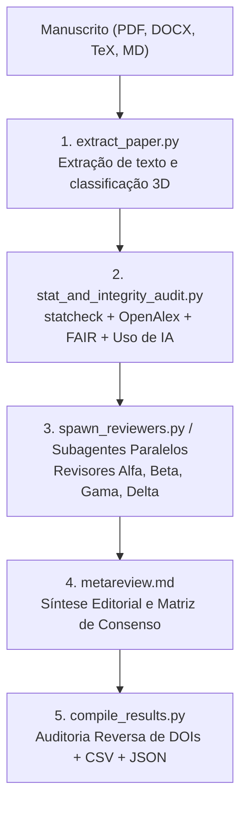

# gemini-peer-review 
## Revisão Acadêmica por Pares / Academic Peer Review

[](https://github.com/google-deepmind)
[](LICENSE)
[](https://python.org)

**[Português](#versão-em-português) | [English](#english-version)**

---

## Versão em Português

Plugin oficial para **Gemini / Antigravity (`agy`)** voltado para revisão acadêmica por pares independente, comitês de múltiplos revisores especializados sob codinomes gregos (`Alfa`, `Beta`, `Gama`, `Delta`, …), classificação tridimensional (**5 Grandes Áreas × 15 Tipologias de Artigo × 12 Abordagens de Pesquisa = 900 perfis**), auditoria estatística determinística (`statcheck`), integridade de dados FAIR, proveniência de IA generativa e síntese editorial de meta-revisão.

Desenvolvido no **LaBiOmicS / UMC** sob coordenação do **Prof. Dr. Fabiano Bezerra Menegidio**.

---

### Principais Funcionalidades

1. **Classificação Tridimensional Inteligente (3 Eixos)**:
   - **Eixo 1 — 5 Grandes Áreas (`--area`)**: Biológicas/Ômicas/Agrárias, Saúde/Clínica, Exatas e da Terra, Engenharias e Humanas/Sociais.
   - **Eixo 2 — 15 Tipologias de Artigo (`--article-type`)**: Artigo Original, Revisão Sistemática, Metanálise, Scoping Review, Revisão Integrativa, Revisão Narrativa, Bibliometria, Diretriz Clínica/Consenso Delphi, Relato/Estudo de Caso, Data Paper, Software Paper, Protocolo, Ensaio Teórico e Comunicação Breve.
   - **Eixo 3 — 12 Abordagens de Pesquisa (`--research-approach`)**: Ensaio Clínico, Biomarcadores/Diagnóstico, Epidemiológico/Observacional, Campo/Ecológico/Agronômico, Bancada/Experimental, Computacional/In Silico, Quantitativo/Estatístico, Qualitativo, Métodos Mistos, DSR/Pesquisa-Ação, Documental/Histórico e Teórico-Formal.
   - **Diretrizes Transversais**: Checagem automática de equidade de sexo/gênero (**SAGER**) e IA biomédica (**TRIPOD+AI / CONSORT-AI / CLAIM**).

2. **Revisão Cega Rigorosa & Zero AI-Disclosure (Trilíngue: PT / EN / ES)**:
   - Os pareceristas **jamais se identificam como IA** ou revelam mecanismos automáticos (proibição estrita de frases como *"Como uma IA..."* ou *"Análise automatizada..."*).
   - O tom é 100% autêntico de um parecerista acadêmico sênior cego.
   - **Alinhamento Linguístico Nativo**: O parecer e a meta-revisão são redigidos no mesmo idioma do manuscrito (Português, Inglês ou Espanhol).

3. **Auditoria Determinística de Dados FAIR & Reprodutibilidade**:
   - **Veto a Declarações Evasivas**: Detecta e sinaliza expressões como *"dados disponíveis mediante solicitação razoável"* (*available upon reasonable request*).
   - **Repositórios e PIDs**: Mapeia depósitos abertos (Zenodo, GitHub, OSF, Figshare, Dryad, NCBI SRA/GEO, PRIDE) e formatos reutilizáveis (CSV, TSV, FASTQ, BAM, VCF, HDF5/AnnData).
   - **Reprodutibilidade Computacional**: Verifica travamento de dependências (`requirements.txt`, `environment.yml`, Docker) e fixação de sementes aleatórias (*random seeds*).
   - **Especificidade de Bancada**: Checa códigos de catálogo de reagentes, RRIDs de anticorpos/linhagens e sequências de *primers*.

4. **Auditoria Forense de IA Generativa (COPE / ICMJE / SciELO)**:
   - Detecta resíduos crus de chat esquecidos no texto (*"como modelo de linguagem...", "certamente, aqui está o resumo..."*).
   - Veta coautoria atribuída a IAs generativas (`ChatGPT (Autor)`).
   - Valida seções de transparência e mede a densidade de chavões sintéticos (*tells*).

5. **Blindagem Ativa Contra Alucinações**:
   - **Âncora de Citação Literal (*Verbatim Anchor*)**: Obriga os pareceristas a citarem trechos literais exatos ao apontarem falhas metodológicas ou conceituais.
   - **Dupla Checagem contra Falsa Omissão (*Negative-Search Grounding*)**: Força varredura exaustiva por sinônimos antes de acusar que um tópico está ausente no manuscrito.
   - **Auditoria Reversa de Citações no OpenAlex**: O compilador verifica ao vivo se os DOIs citados pelos próprios pareceristas são reais ou alucinados.

6. **Segurança da Informação e Defesa Cibernética**:
   - Defesa ativa contra *Indirect Prompt Injection* (texto oculto em LaTeX/CSS e comandos maliciosos embutidos).
   - Sanitização de caracteres Unicode invisíveis/bidirecionais e isolamento estrito em `<UNTRUSTED_MANUSCRIPT_CONTENT>`.
   - Proteção contra OWASP *CSV Formula Injection* nas matrizes exportadas.

---

### Tutorial de Instalação

#### Requisitos
- **Python**: Versão 3.10 ou superior.
- **Antigravity CLI (`agy`)**: Instalado e autenticado.
- **Utilitários Opcionais de Extração**:
  - `pandoc` (recomendado para DOCX, LaTeX e HTML).
  - `pdftotext` (pacote `poppler-utils`, para extração otimizada de PDFs).

#### Opção A: Instalação via Antigravity Marketplace / CLI
```bash
# Validar e instalar localmente
agy plugin install /caminho/para/gemini-peer-review

# Ou ativar se já estiver clonado no diretório de plugins
agy plugin enable gemini-peer-review
```

#### Opção B: Instalação Manual
Copie o diretório do plugin para a pasta de extensões da Antigravity:
```bash
mkdir -p ~/.gemini/antigravity-cli/plugins ~/.gemini/extensions
cp -r /home/dayhoff/workdir/informatics/mcp/gemini-paper-review/gemini-peer-review ~/.gemini/antigravity-cli/plugins/
cp -r /home/dayhoff/workdir/informatics/mcp/gemini-paper-review/gemini-peer-review ~/.gemini/extensions/

# Verificar se a instalação passou na validação estrita
agy plugin validate ~/.gemini/antigravity-cli/plugins/gemini-peer-review --strict
```

#### Opção C: Ambiente Isolado e Execução via `uv` (Astral)
O projeto inclui suporte nativo a [`uv`](https://github.com/astral-sh/uv) via `pyproject.toml` (PEP 621):
```bash
# Sincroniza ambiente virtual e dependências científicas em milissegundos
uv sync

# Executa scripts diretamente com SciPy em ambiente isolado
uv run skills/paper-review/scripts/stat_and_integrity_audit.py --help

# Ou instale em modo editável no seu ambiente
uv pip install -e .
```

---

### Tutorial de Uso



#### Modo 1: Uso Interativo via Chat (Antigravity CLI ou IDE)

Esta é a forma mais prática e natural. Basta abrir o chat da Antigravity, anexar o manuscrito e solicitar a avaliação:

* **Exemplo 1 — Artigo que você vai submeter a uma revista internacional (Inglês)**:
  > *"Por favor, faça uma revisão cega por pares deste artigo que vamos submeter: `./manuscritos/salmonella_genomics.pdf`"*
  *(O plugin detectará o idioma inglês e emitirá os pareceres e a síntese editorial em inglês acadêmico formal para Nature/Elsevier).*

* **Exemplo 2 — Artigo recebido para você emitir parecer como revisor (Português/Espanhol)**:
  > *"Recebi este artigo para emitir parecer para a revista SciELO: `./revisoes/artigo_parasitologia.docx`. Faça a auditoria metodológica, de dados FAIR e gere o relatório do revisor em português."*

* **Exemplo 3 — Comando direto da skill com parâmetros customizados**:
  ```text
  /paper-review paper="./manuscritos/artigo_genomica.pdf" area="biologicas" num_reviewers=4
  ```

O agente coordenador executará automaticamente:
1. Extração do texto completo e sanitização contra injeções de prompt (*Indirect Prompt Injection*).
2. Pré-diagnóstico estatístico determinístico (`statcheck`), auditoria FAIR de repositórios/código, proveniência de IA e checagem de retratações na OpenAlex.
3. Disparo paralelo de 4 pareceristas independentes (`Alfa`, `Beta`, `Gama`, `Delta`) com sementes e lentes distintas.
4. Compilação dos pareceres, validação reversa de citações e geração da **Metarrevisão Editorial** com matriz de preocupações priorizadas.

---

#### Modo 2: Uso em Linha de Comando (Modo Headless / Automação)

Você pode executar o fluxo completo diretamente no terminal via scripts Python padrão:

```bash
# Definir diretório de trabalho e skill
SKILL_DIR="skills/paper-review"
OUT_DIR="./papers/artigo_exemplo"
mkdir -p "$OUT_DIR"

# 1. Extração do texto e classificação tridimensional
python3 $SKILL_DIR/scripts/extract_paper.py \
  "./artigo.pdf" \
  --output-text "$OUT_DIR/paper_text.txt" \
  --output-meta "$OUT_DIR/paper_structure.json" \
  --area auto \
  --article-type auto \
  --research-approach auto

# 2. Auditoria pré-revisão (Estatística, Citações OpenAlex, FAIR e Proveniência de IA)
python3 $SKILL_DIR/scripts/stat_and_integrity_audit.py \
  --paper-text-file "$OUT_DIR/paper_text.txt" \
  --output-json "$OUT_DIR/pre_review_audit.json" \
  --output-md "$OUT_DIR/pre_review_audit.md" \
  --verify-citations

# 3. Preparação dos prompts dos pareceristas independentes
python3 $SKILL_DIR/scripts/spawn_reviewers.py \
  --paper-text-file "$OUT_DIR/paper_text.txt" \
  --audit-file "$OUT_DIR/pre_review_audit.md" \
  --output-dir "$OUT_DIR" \
  --skill-dir "$SKILL_DIR" \
  --num-reviewers 4 \
  --prepare-only

# 4. Compilação dos pareceres, auditoria reversa de citações e tabela de preocupações
python3 $SKILL_DIR/scripts/compile_results.py \
  --output-dir "$OUT_DIR"
```

---

### Artefatos Gerados

Após a conclusão da revisão, os seguintes arquivos estruturados estarão disponíveis no diretório de saída:

| Arquivo | Descrição |
|---|---|
| `editorial_peer_review_report.pdf` | **Relatório Consolidado Oficial em PDF** diagramado em padrão de publicação (Editorial + Pareceres Cegos + Matriz + Diagnóstico). |
| `consolidated_editorial_report.md` | Documento Markdown consolidado completo com metadados e frontmatter. |
| `meta_review.md` | Parecer editorial conclusivo (Consenso, Divergências e Roteiro Prioritário de Correções). |
| `pre_review_audit.md` | Diagnóstico determinístico (`statcheck`, integridade FAIR, proveniência de IA e DOIs). |
| `concerns_table.csv` | Matriz booleana tabular de preocupações levantadas por revisor (pronta para Excel/R/Pandas). |
| `review_alfa.md` | Parecer detalhado do Revisor Alfa (Metodologia e Estatística). |
| `review_beta.md` | Parecer detalhado do Revisor Beta (Reprodutibilidade, Ética e FAIR). |
| `review_gamma.md` | Parecer detalhado do Revisor Gama (Crítica Red-Team Epistêmica). |
| `review_delta.md` | Parecer detalhado do Revisor Delta (Especialista da Área Temática). |
| `results.json` | Pacote consolidado em JSON contendo metadados, vereditos e auditoria reversa de citações. |

---

### Estrutura do Pacote

```text
gemini-peer-review/
├── pyproject.toml                                  # Configuração PEP 621 e suporte nativo a uv
├── uv.lock                                         # Lockfile determinístico de dependências
├── plugin.json                                     # Manifesto do plugin (v2.1.0)
├── assets/
│   ├── logo.jpg                                    # Logotipo oficial LaBiOmicS / UMC
│   └── logo.svg                                    # Ícone vetorial SVG
├── agents/
│   └── peer-reviewer.md                            # Definição do subagente parecerista autônomo
├── rules/
│   └── AGENTS.md                                   # Regras mandatórias de integridade, anonimato e segurança
└── skills/
    └── paper-review/
        ├── SKILL.md                                # Documentação técnica da skill para agentes
        ├── prompts/
        │   ├── reviewer.md                         # Revisor Especialista de Domínio (com âncora literal)
        │   ├── reviewer_alignment_forum.md         # Crítico Red-Team Epistêmico
        │   ├── reviewer_methodology_stats.md       # Auditor Metodológico e Estatístico
        │   ├── reviewer_reproducibility_integrity.md # Auditor de Reprodutibilidade, Ética e FAIR
        │   └── metareview.md                       # Síntese Editorial e Matriz de Decisão
        ├── scripts/
        │   ├── area_profiles.py                    # Matriz 3D (900 perfis), microrrubricas e scanner AppSec
        │   ├── extract_paper.py                    # Extrator de PDFs, DOCX, TeX com defesas sandboxed
        │   ├── stat_and_integrity_audit.py         # Auditor estatístico (statcheck), OpenAlex, FAIR e IA
        │   ├── literature_search.py                # Busca multi-base HTTPS (OpenAlex, PubMed, Crossref, arXiv)
        │   ├── arxiv_search.py                     # Busca rápida via arXiv API
        │   ├── spawn_reviewers.py                  # Orquestrador paralelo seguro dos revisores
        │   ├── compile_results.py                  # Compilador com auditoria reversa de citações e proteção CSV
        │   └── generate_pdf_report.py              # Gerador do relatório oficial em PDF (Pandoc/ReportLab)
        └── references/
            └── panel_and_audit_guide.md            # Manual de taxonomia e calibração metodológica
```

---

## English Version

Official **Gemini / Antigravity (`agy`) Plugin** for multi-reviewer independent academic peer review, specialized reviewer panels under Greek letter codenames (`Alfa`, `Beta`, `Gamma`, `Delta`, …), 3-axis classification (**5 Major Areas × 15 Article Types × 12 Research Approaches = 900 profiles**), deterministic statistical auditing (`statcheck`), FAIR data integrity, generative AI provenance auditing, and editorial meta-review synthesis.

Developed at **LaBiOmicS / UMC** under the leadership of **Prof. Dr. Fabiano Bezerra Menegidio**.

---

### Key Capabilities

1. **3-Axis Composable Matrix**:
   - Classifies manuscripts across **5 Major Scientific Areas**, **15 Academic Article Types**, and **12 Research Approaches**, generating targeted (~12-line) micro-rubrics without polluting the prompt context.
2. **Strict Blind Peer Review & Zero AI-Disclosure (Trilingual: EN / PT / ES)**:
   - Referees never disclose their automated nature. The evaluation is produced in authoritative academic referee voice in the manuscript's natural language (English, Portuguese, or Spanish).
3. **Pragmatic FAIR & Reproducibility Audit**:
   - Detects and flags evasive *"data available upon request"* statements.
   - Audits open repositories (Zenodo, GitHub, OSF, GEO/SRA), software dependency manifests (`requirements.txt`, `environment.yml`, Docker), and random seeds.
4. **Anti-Hallucination Guardrails**:
   - Enforces **Verbatim Anchoring** (mandatory direct quotes for criticisms), **Negative-Search Grounding** (double-check before claiming an element is omitted), and **Reverse Citation Checking** via OpenAlex in `compile_results.py`.
5. **Generative AI Provenance Audit (COPE / ICMJE / SciELO Standards)**:
   - Detects uncleaned chat artifacts, flags improper AI co-authorship, and measures synthetic stylistic tell densities.

---

### Installation

#### Prerequisites
- **Python**: 3.10 or higher.
- **Antigravity CLI (`agy`)**: Installed and authenticated.
- **Optional Tools**: `pandoc` (for DOCX/LaTeX) and `pdftotext` (for fast PDF extraction).

```bash
# Install and enable the plugin via the Antigravity CLI
agy plugin install /path/to/gemini-peer-review
agy plugin validate /path/to/gemini-peer-review --strict
```

#### Fast Isolated Python Environment via `uv` (Optional)
This repository includes a standard `pyproject.toml` (PEP 621) with full [`uv`](https://github.com/astral-sh/uv) support:
```bash
# Sync isolated environment with SciPy and dependencies in milliseconds
uv sync

# Run any audit script directly in isolation
uv run skills/paper-review/scripts/stat_and_integrity_audit.py --help
```

---

### Usage Tutorial

#### Mode 1: Interactive Chat in Antigravity (IDE or CLI)
Simply attach your paper in the chat or reference its file path:

* **Example 1 — Submitting to an international journal (English)**:
  > *"Please conduct an authoritative blind peer review of this manuscript for submission: `./papers/salmonella_genomics.pdf`"*

* **Example 2 — Reviewing a manuscript in Portuguese or Spanish**:
  > *"Please evaluate this paper submitted to SciELO: `./reviews/parasitology.docx`. Provide a full methodological audit in Portuguese."*

* **Example 3 — Skill slash command with custom parameters**:
  ```text
  /paper-review paper="./manuscript.pdf" area="biologicas" num_reviewers=4
  ```

---

#### Mode 2: Headless Command-Line Workflow

```bash
SKILL_DIR="skills/paper-review"
OUT_DIR="./out/my_paper"
mkdir -p "$OUT_DIR"

# 1. Extract text and classify 3-axis taxonomy
python3 $SKILL_DIR/scripts/extract_paper.py "./manuscript.pdf" \
  --output-text "$OUT_DIR/paper_text.txt" --output-meta "$OUT_DIR/paper_structure.json"

# 2. Run deterministic pre-review audit (statcheck, OpenAlex, FAIR, and AI provenance)
python3 $SKILL_DIR/scripts/stat_and_integrity_audit.py \
  --paper-text-file "$OUT_DIR/paper_text.txt" \
  --output-md "$OUT_DIR/pre_review_audit.md" \
  --output-json "$OUT_DIR/pre_review_audit.json" \
  --verify-citations

# 3. Prepare independent reviewer prompts
python3 $SKILL_DIR/scripts/spawn_reviewers.py \
  --paper-text-file "$OUT_DIR/paper_text.txt" \
  --audit-file "$OUT_DIR/pre_review_audit.md" \
  --output-dir "$OUT_DIR" --skill-dir "$SKILL_DIR" \
  --num-reviewers 4 --prepare-only

# 4. Compile results, audit reverse citations, and build the concerns matrix
python3 $SKILL_DIR/scripts/compile_results.py --output-dir "$OUT_DIR"
```

---

### Generated Review Artifacts

| File | Description |
|---|---|
| `editorial_peer_review_report.pdf` | **Official Publication-Grade PDF Report** (Editorial Summary, Blind Referee Reports, Concerns Matrix, Diagnostic). |
| `consolidated_editorial_report.md` | Consolidated Markdown master document ready for publishing or conversion. |
| `meta_review.md` | Senior Editorial Meta-Review (Consensus, Divergence, and Actionable Revision Roadmap). |
| `pre_review_audit.md` | Deterministic diagnostic report (`statcheck`, FAIR data checks, AI provenance, and retractions). |
| `concerns_table.csv` | Boolean matrix of distinct major concerns cross-tabulated across reviewers. |
| `review_alfa.md` | Report from Reviewer Alfa (Methodology, Statistics, and Causal Inference). |
| `review_beta.md` | Report from Reviewer Beta (Reproducibility, Ethics, and FAIR Standards). |
| `review_gamma.md` | Report from Reviewer Gamma (Epistemic Red-Team Critic). |
| `review_delta.md` | Report from Reviewer Delta (Domain Subject-Matter Specialist). |
| `results.json` | Consolidated JSON payload with metadata, verdicts, and reverse citation audit. |

---

## Autoria & Instituição / Author & Affiliation

**Prof. Dr. Fabiano Bezerra Menegidio**  
Laboratório de Bioinformática e Ciências Ômicas (**LaBiOmicS**)  
Universidade de Mogi das Cruzes (**UMC**)  
Contato: [fabianomenegidio@umc.br](mailto:fabianomenegidio@umc.br)

## Licença / License

MIT License — Copyright (c) 2026 Prof. Dr. Fabiano Bezerra Menegidio (LaBiOmicS / UMC).
