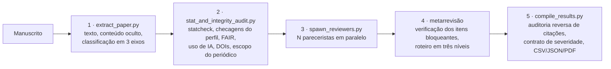

# academic-peer-review

[](https://github.com/LaBiOmicS/academic-peer-review/actions/workflows/ci.yml)
[](https://github.com/LaBiOmicS/academic-peer-review/releases)
[](LICENSE)
[](https://www.python.org)
[](https://labiomics.github.io/academic-peer-review/)

[English](README.md) · **Português** · [Español](README.es.md)

Plugin para **Claude Code** e **Antigravity (`agy`)** que produz uma revisão por pares de manuscritos científicos assistida por IA. Primeiro roda uma auditoria determinística. Em seguida, um painel de agentes pareceristas independentes, cada um com um papel distinto, escreve os pareceres, e uma metarrevisão editorial os sintetiza com severidade calibrada. O resultado é um conjunto de arquivos Markdown, CSV e JSON e um relatório em PDF.

Os relatórios são rascunhos para um parecerista ou editor humano, que é responsável por verificá-los, editá-los e assiná-los.

---

## Sumário

- [Visão geral](#visão-geral)
- [Fluxo](#fluxo)
- [Painel de pareceristas](#painel-de-pareceristas)
- [Calibração de severidade](#calibração-de-severidade)
- [Auditoria determinística](#auditoria-determinística)
- [Classificação do manuscrito](#classificação-do-manuscrito)
- [Modelo de segurança](#modelo-de-segurança)
- [Instalação](#instalação)
- [Uso](#uso)
- [Parâmetros](#parâmetros)
- [Saídas](#saídas)
- [Limitações](#limitações)
- [Desenvolvimento](#desenvolvimento)
- [Como citar](#como-citar)
- [Licença e autoria](#licença-e-autoria)

---

## Visão geral

| | |
|---|---|
| **Ambientes** | Claude Code (subagentes nativos) · Antigravity CLI · subprocessos headless (`claude -p`, `agy -p`, `gemini -p`) |
| **Formatos de entrada** | PDF, DOCX, LaTeX, Markdown, texto puro, reStructuredText; ODT, RTF, HTML e EPUB via pandoc |
| **Idioma do relatório** | O do manuscrito (português, inglês ou espanhol) |
| **Tamanho do painel** | 3 a 8 pareceristas (padrão 5), opcionalmente em modelos diferentes |
| **Classificação** | 5 áreas × 15 tipologias × 13 abordagens = 975 perfis |
| **Serviços externos** | OpenAlex, doi.org, arXiv, Europe PMC, Crossref (somente leitura, HTTPS) |
| **Execução** | Python ≥ 3.10; dependências declaradas no próprio script (PEP 723) e resolvidas pelo `uv` |

## Fluxo



As etapas 1, 2 e 5 são determinísticas e cobertas pela suíte de testes. Modelos de linguagem entram apenas nas etapas 3 e 4.

## Painel de pareceristas

Os papéis são preenchidos em ordem de prioridade e depois embaralhados entre os codinomes gregos (`alfa`, `beta`, `gamma`, …), de modo que o codinome não revela o papel.

| Pareceristas | Composição |
|---|---|
| 3 | crítico *red-team*, advogado do autor, auditor de metodologia e estatística |
| 4 | + inspetor de reprodutibilidade, ética e FAIR |
| 5 (padrão) | + parecerista de domínio |
| 6–8 | + outros pareceristas de domínio |

- **Crítico *red-team***: procura a falha que invalidaria a conclusão principal, ao longo de um eixo de ataque sorteado de uma tabela própria da área ou da tipologia.
- **Advogado do autor**: confronta as críticas prováveis com o que o manuscrito já diz e aponta exigências desproporcionais ou alheias ao gênero do artigo.
- **Auditor de metodologia e estatística**: delineamento, validade dos indicadores, inferência estatística.
- **Inspetor de reprodutibilidade**: consistência interna, disponibilidade de dados e código, declarações, diretrizes de relato.
- **Parecerista de domínio**: originalidade, estado da arte, mérito na área e adequação ao periódico.

Cada parecerista recebe uma semente que escolhe sua lente analítica e sua postura (*String Seed of Thought*). Os pareceristas não veem os pareceres uns dos outros. Com 3 ou 4 pareceristas, o painel não tem parecerista de domínio.

**Painéis com vários modelos.** `panel_models` (por exemplo, `claude:opus,agy,claude:sonnet`) atribui um par `runner:modelo` a cada parecerista, em rodízio. Pareceristas no mesmo modelo compartilham seus pontos cegos, por isso a metarrevisão só dá peso à concordância quando ela vem de modelos diferentes. Os modelos usados ficam registrados em `results.json`.

## Calibração de severidade

Cada crítica principal tem um nível:

| Nível | Definição | Limite |
|---|---|---|
| **Bloqueante** | Uma conclusão declarada não se sustenta sem a mudança; o parecerista a cita | ≤ 5 por parecer |
| **Essencial** | Relato, transparência e declarações no padrão da tipologia | — |
| **Opcional** | Ampliações de escopo e análises novas que os autores podem recusar com uma justificativa de uma linha | — |

Antes de levantar uma crítica, o parecerista procura no texto as ressalvas que os autores já fizeram e confere a direção de qualquer viés que alegue. Um último ano incompleto, por exemplo, subestima a contagem em vez de inflá-la. A lente sorteada é tratada como hipótese a testar.

A metarrevisão não conta concordância entre pareceristas como evidência. Todo candidato a item bloqueante passa por uma tabela de verificação com as colunas: conclusão em jogo, tratamento que os autores já deram, direção do viés, remédio proporcional e nível final. O `compile_results.py` verifica esse contrato (níveis presentes, no máximo 5 bloqueantes, tabela de verificação e roteiro em três níveis) e acusa violações como `SEVERITY CONTRACT NOT MET`. Ele também insere os números da auditoria na metarrevisão e avisa quando o texto os contradiz.

## Auditoria determinística

| Módulo | Verificações |
|---|---|
| `statcheck` | Recalcula valores-p a partir de *t*, *F*, *r*, χ² e *z*; aponta inconsistências, erros de decisão e valores frágeis |
| Checagens do perfil | Itens de relato da tipologia e da abordagem (PRISMA, CONSORT, STROBE, ARRIVE, COREQ, BIBLIO etc.), inclusive se a string de busca está no texto, num protocolo externo ou no suplemento |
| FAIR e reprodutibilidade | Repositórios e identificadores persistentes, declarações de disponibilidade evasivas, travamento de dependências, sementes aleatórias, RRIDs, números de catálogo |
| IA generativa | Restos de conversa com chatbot, IA listada como autora, presença de declaração de uso de IA |
| Citações | DOIs conferidos no OpenAlex e no doi.org; retratações; IDs do arXiv na API do arXiv |
| Escopo do periódico | Adequação aos tópicos do periódico-alvo (perfis curados ou OpenAlex Sources), requisitos formais, risco de *desk reject* |
| Conteúdo oculto | Texto invisível ao leitor humano (texto branco, microscópico ou fora da página no PDF, trechos ocultos no DOCX, comentários LaTeX/HTML/Markdown) |

## Classificação do manuscrito

O manuscrito é classificado em três eixos, que juntos definem a rubrica dos pareceristas, as checagens da auditoria e as tabelas de lentes.

- **Área (5):** ciências biológicas e agrárias, saúde, ciências exatas e da terra, engenharias, humanidades e ciências sociais.
- **Tipologia (15):** pesquisa original, revisão sistemática, metanálise, revisão guarda-chuva, revisão de escopo, revisão integrativa, revisão narrativa, revisão bibliométrica, diretriz/consenso, estudo de caso, *data paper*, *software paper*, métodos/protocolo, ensaio teórico, comunicação breve.
- **Abordagem (13):** clínica/intervencional, diagnóstica/prognóstica, epidemiológica/observacional, de campo/ecológica/agronômica, experimental/laboratorial, computacional/*in silico*, quantitativa, qualitativa, métodos mistos, pesquisa-ação/*design science*, documental/arquivística, bibliométrica/cienciométrica, teórica/formal.

Tipologias que analisam metadados, como a revisão bibliométrica, têm tabelas próprias de lentes e de *red-team* e não recebem exigências de estudo primário (réplicas, poder, FDR, aprovação ética). As checagens transversais só se aplicam quando pertinentes: SAGER quando o manuscrito envolve pessoas ou animais, e TRIPOD+AI / CLAIM quando contém um modelo de IA.

A classificação é feita por palavras-chave. Quando a evidência para um eixo é fraca, o eixo é marcado `needs_confirmation`, e o agente confere título, resumo e métodos, perguntando ao usuário em sessões interativas. Eixos informados explicitamente não são reavaliados.

## Modelo de segurança

- O texto do manuscrito vai envolto em `<UNTRUSTED_MANUSCRIPT_CONTENT>` e é tratado como dado. Instruções embutidas nele nunca são seguidas.
- Texto oculto dirigido a revisores de IA é removido da cópia dos pareceristas e informado ao editor como possível caso de integridade. Ele nunca decide o veredito.
- Caracteres Unicode invisíveis e bidirecionais são removidos. As células dos CSV exportados são protegidas contra injeção de fórmulas.
- Pareceristas headless rodam com ambiente sanitizado (apenas as credenciais do runner escolhido) e, por padrão, dentro do sandbox do runner (`tool_permissions=sandboxed`).
- Requisições externas são apenas HTTPS, somente leitura e com limite de tamanho. Respostas XML com declarações DTD ou de entidades são rejeitadas.

## Instalação

**Requisitos:** Python ≥ 3.10, [`uv`](https://github.com/astral-sh/uv) e Claude Code ou Antigravity CLI instalados e autenticados. Opcionais: `pandoc` com um motor LaTeX para o PDF tipografado (sem ele, o PDF é gerado com ReportLab) e `pdftotext` (poppler-utils) para PDFs em duas colunas.

### Claude Code

```text
/plugin marketplace add LaBiOmicS/academic-peer-review
/plugin install academic-peer-review@labiomics
```

### Script de instalação (Claude Code e Antigravity)

```bash
git clone https://github.com/LaBiOmicS/academic-peer-review.git
cd academic-peer-review
./install.sh
```

O script sincroniza o ambiente Python e registra o plugin nas CLIs que estiverem instaladas.

### Antigravity CLI

```bash
agy plugin validate ./academic-peer-review --strict
agy plugin install ./academic-peer-review
agy plugin enable academic-peer-review
```

## Uso

### Interativo

```text
/paper-review paper="./manuscrito.pdf" target_journal="Bioinformatics" num_reviewers=5
```

Um pedido em linguagem natural também funciona, por exemplo *"Faça uma revisão cega de ./manuscrito.pdf para a PLOS ONE"*. No Claude Code, use `/academic-peer-review:paper-review` se outro plugin também oferecer uma skill `paper-review`.

### Headless

```bash
SKILL=skills/paper-review
OUT=./out/meu_artigo

uv run $SKILL/scripts/extract_paper.py ./manuscrito.pdf \
  --output-text $OUT/paper_text.txt --output-meta $OUT/paper_structure.json

uv run $SKILL/scripts/stat_and_integrity_audit.py \
  --paper-text-file $OUT/paper_text.txt --paper-meta $OUT/paper_structure.json \
  --output-md $OUT/pre_review_audit.md --output-json $OUT/pre_review_audit.json \
  --journal "Nome do Periódico" --verify-citations

uv run $SKILL/scripts/spawn_reviewers.py \
  --paper-text-file $OUT/paper_text.txt --audit-file $OUT/pre_review_audit.md \
  --output-dir $OUT --skill-dir $SKILL --num-reviewers 5 \
  --runner auto --panel-models "claude:opus,agy,claude:sonnet"

# escreva $OUT/meta_review.md seguindo $SKILL/prompts/metareview.md e depois:
uv run $SKILL/scripts/compile_results.py --output-dir $OUT
```

`--prepare-only` grava os prompts dos pareceristas e o `panel_manifest.json` sem abrir subprocessos, para ambientes que rodam os pareceristas como subagentes nativos. Rodar `spawn_reviewers.py` de novo sem `--overwrite` mantém os pareceres válidos e os papéis e sementes do painel, e relança só os pareceristas que falharam.

### Custo e tempo

Cada revisão custa uma chamada de modelo por parecerista, mais a metarrevisão. Como referência, um manuscrito de ~1.000 palavras com 3 pareceristas no Claude Sonnet custou cerca de US$ 1. Um artigo de ~9.000 palavras leva de 3 a 5 minutos por parecerista, com os pareceristas em paralelo.

## Parâmetros

| Parâmetro | Padrão | Descrição |
|---|---|---|
| `paper` | — | Caminho do manuscrito (obrigatório) |
| `area`, `article_type`, `research_approach` | `auto` | Fixa qualquer eixo da classificação |
| `domain` | inferido | Subárea, por exemplo `"microbiologia do solo"` |
| `target_journal` | `""` | Periódico para a auditoria de escopo e de *desk reject* |
| `num_reviewers` | `5` | Tamanho do painel, de 3 a 8 |
| `panel_models` | `""` | Entradas `runner[:modelo]` separadas por vírgula, para um painel com vários modelos |
| `alignment_critic` / `author_advocate` / `specialist_panel` | `true` | Incluir o crítico *red-team* / o advogado do autor / os auditores especialistas |
| `verify_citations` | `true` | Consultar OpenAlex e doi.org sobre DOIs e retratações |
| `execution_mode` | `auto` | `subagents` ou `cli` (subprocessos headless) |
| `tool_permissions` | `sandboxed` | Só headless: `sandboxed`, `none` ou `unsafe` |
| `overwrite` | `false` | Descartar os pareceres existentes e sortear um painel novo |

`compile_results.py --no-ai-disclosure` omite do PDF o aviso de assistência por IA. A declaração à revista passa então a ser responsabilidade do parecerista.

## Saídas

| Arquivo | Conteúdo |
|---|---|
| `editorial_peer_review_report.pdf` | Relatório consolidado: metarrevisão, matriz de críticas, auditoria, pareceres individuais |
| `meta_review.md` | Vereditos, críticas comuns e únicas, verificação dos bloqueantes, roteiro em três níveis, decisão |
| `author_letter.md` | Decisão com apenas os itens bloqueantes e essenciais |
| `review_<codinome>.md` | Um parecer por parecerista |
| `pre_review_audit.md` / `.json` | Auditoria determinística |
| `concerns_table.csv` / `concerns_matrix.json` | Críticas × pareceristas, com nível de severidade e `major` / `minor` por parecerista |
| `results.json` | Vereditos, papéis, runners e modelos, auditoria reversa de citações, contrato de severidade, hash da auditoria |
| `consolidated_editorial_report.md` | Fonte Markdown do PDF |

## Limitações

- **Não substitui a revisão por pares.** Os relatórios são rascunhos. Os pareceristas podem ler mal um manuscrito, e a concordância entre pareceristas no mesmo modelo não é corroboração independente.
- **Confidencialidade.** Enviar um manuscrito inédito a um serviço de IA pode violar a política de revisão do periódico (COPE, ICMJE e muitas editoras restringem isso). Confira antes de usar a ferramenta como parecerista convidado. Autores que revisam o próprio trabalho antes da submissão não têm essa restrição.
- **Classificação por palavras-chave.** Manuscritos atípicos podem ser mal classificados. Eixos de baixa confiança são marcados para confirmação, e qualquer eixo pode ser fixado.
- **Escopo do periódico.** Só periódicos com perfil curado têm requisitos verificados. Para os demais, o escopo é estimado pelos tópicos do OpenAlex, e os requisitos são apresentados como típicos, não verificados.
- **Estatística.** O `statcheck` só reconhece expressões completas de teste no formato APA ou semelhante.

## Desenvolvimento

```bash
uv sync --all-extras
uv run pytest -q                       # suíte de testes (o acesso à rede é bloqueado nos testes)
uvx ruff check skills tests            # lint
agy plugin validate . --strict         # validação do manifesto
```

```text
skills/paper-review/
├── SKILL.md                 # instruções de orquestração para o agente hospedeiro
├── prompts/                 # modelos dos pareceristas e prompt da metarrevisão
├── scripts/                 # extração, auditoria, painel, compilação, PDF
└── references/              # taxonomia e guia de calibração
agents/peer-reviewer.md      # definição do subagente parecerista
rules/AGENTS.md              # regras de integridade, anonimato e segurança
site/                        # página do projeto (GitHub Pages)
tests/                       # suíte pytest
```

As mudanças estão registradas em [CHANGELOG.md](CHANGELOG.md).

## Como citar

```bibtex
@software{menegidio_academic_peer_review,
  author  = {Menegidio, Fabiano Bezerra},
  title   = {academic-peer-review: AI-assisted academic peer review with deterministic audits},
  year    = {2026},
  version = {1.2.0},
  url     = {https://github.com/LaBiOmicS/academic-peer-review},
  note    = {LaBiOmicS, Universidade de Mogi das Cruzes}
}
```

## Licença e autoria

Licença MIT. Copyright © 2026 Fabiano Bezerra Menegidio.

Desenvolvido no Laboratório de Bioinformática e Ciências Ômicas (**LaBiOmicS**), Universidade de Mogi das Cruzes (**UMC**), Brasil. Contato: [fabianomenegidio@umc.br](mailto:fabianomenegidio@umc.br).
